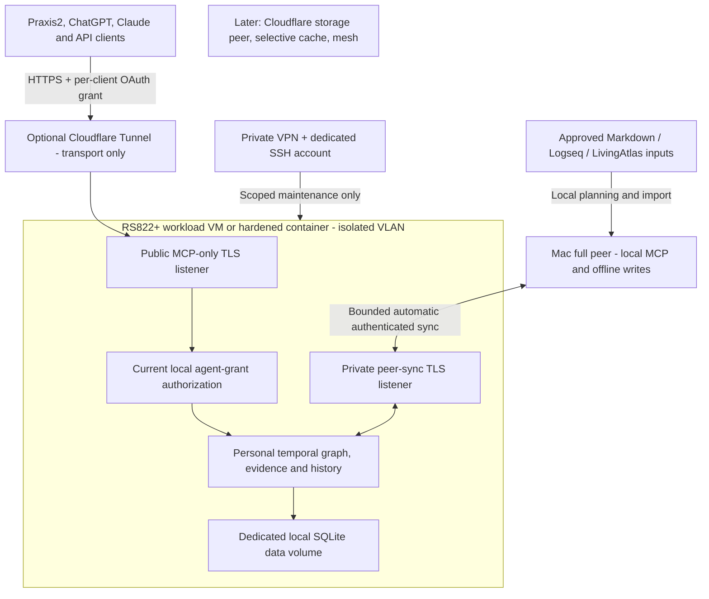

# Personal v1 architecture

**Accepted deployment direction, 7 November 2026:** a normally available NAS-hosted Linux peer plus an independently writable Mac peer. The existing graph engine is implemented; the NAS/OAuth/automatic-sync extension is authorized and defined in [NAS-CONTRACT.md](NAS-CONTRACT.md). Its new test results must be recorded separately from the earlier baseline.

DSM and existing NAS services remain on the main LAN. The workload gets a separate identity and isolated VLAN, preferably in a small Linux VM with hardened containers. Public MCP and private synchronization use separate TLS listeners over the same local Store. Cloudflare is an optional outbound tunnel only. It does not hold the knowledge database, and there is no Workers/Durable Objects data port in this release. Primary endpoint does not confer sole-writer or owner authority.

The [editable diagram](diagrams/personal-v1.mmd) contains no private endpoint or secret. OAuth uses a maintained authorization server with a strictly validated resource-server adapter and current local agent grants. Full personal-store read access is authorized independently for each app/API connection. A container bridge alone is not proof of LAN isolation; effective VLAN, host and IPv6 rules must be verified on the NAS. See [deployment](NAS-DEPLOYMENT.md) and [maintenance access](REMOTE-ADMIN.md).

## Knowledge contract

Stable entity IDs represent identities. Assertions represent sourced facts and typed relationships; changing names or affiliations are assertions, not destructive identity edits. Preserve unresolved observations without inventing entities or dates. Evidence identifies the source and captured version. Separate direct source statements, extraction, model inference and review attribution.

World time describes when a claim held. Knowledge time describes when a specific peer acquired/applied the claim or correction. Retain origin metadata separately from each peer's receipt/application history. Queries name a local knowledge position or shared causally closed frontier. At a shared frontier, semantic answers converge; the peers' earlier local-known histories may differ. Unknown dates are not sortable sentinel values, and half-open interval/precision rules must be consistent across search and traversal.

Correction, retraction, invalidation and reinstatement are distinct semantic operations. Competing sources are not automatically revisions of one claim. Concurrent revisions retain branches until an authorized resolution. Administrative deletion and physical erasure are separate from changing a historical belief. Return evidence, lineage, unresolved alternatives, temporal fidelity and coverage with answers. Derived indexes and summaries never become a second source of truth.

## Durable operation and personal sync

An admitted semantic operation group and its required local metadata become durable before acknowledgment and visible atomically. Received operations wait for required dependencies. Use stable operation identities and safe retries. Clock skew, duplicate delivery and delivery order must not silently discard a correction.

Peers authenticate each other and operate within the owner's admitted store. Test offline writes on both, concurrent corrections, interrupted exchange, missing dependencies, stale rejoin, restart and restore. A successful two-peer test does not establish a transitive relay mesh. Fine-grained subscriptions and larger meshes are separate later choices.

## Import and migration

V1 supports Markdown/Logseq and prior LivingAtlas data. First inventory the actual generations and available artifacts without altering originals. Define explicit conversions for source identity, original world/knowledge semantics, evidence, correction lineage, IDs or ID mappings, and import-time knowledge. Do not backdate when RefactoredMemory itself learned imported material.

Unchanged reimports are idempotent; changed source versions preserve earlier evidence and use declared correction/update rules. Inventory every input with imported, unchanged, unsupported, quarantined or failed status. Preserve unresolved content and fidelity gaps rather than guessing equivalence or silently skipping it. Keep an original backup, versioned mappings and a rollback path.

Legacy decryption support is an import compatibility concern when an existing source is encrypted. Use only authorized original keys in the approved environment. It does not require a new v1 encryption architecture. Missing artifacts or keys remain explicit blockers for the affected migration path; development uses synthetic fixtures until real-data access is separately authorized.

## Personal protection and later evolution

V1 requires local access controls, scoped MCP client/agent grants, authenticated peers, HTTPS/TLS for remote transport, bounded inputs/queries, and safe logs. Source text cannot grant permissions or execute tools. Current authority applies to historical queries. Model-inferred additions are automatically accepted within configured client/agent grants, without per-item human review. Preserve evidence, actor/model/derivation attribution, uncertainty, conflicts and correction history; acceptance is not human verification or established truth. Q7 authorizes proactive client capture within grants. Q8 prefers explicit authenticated owner corrections while retaining contradictory claims and evidence. Q9 selects MCP and CLI first. Q10 requires the project-decision, relationship-evidence and recent-changes journeys.

Product content encryption, corporate ownership boundaries and multitenancy are deferred. Stable IDs, versioned semantic contracts, provenance and portable export preserve a practical migration path. Future tenancy/custody must not introduce a prerequisite enterprise framework into personal v1.
