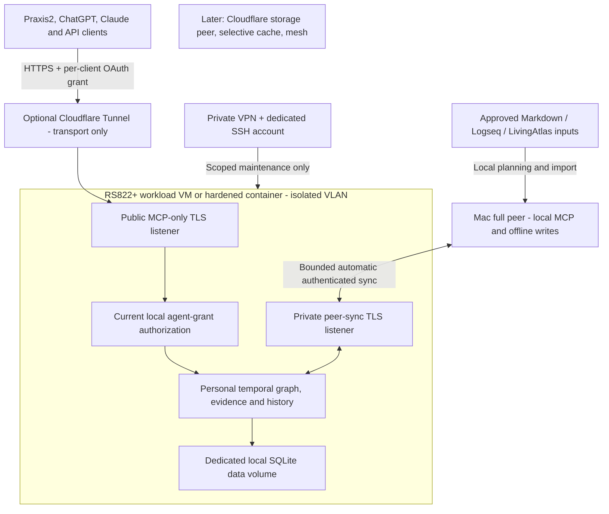
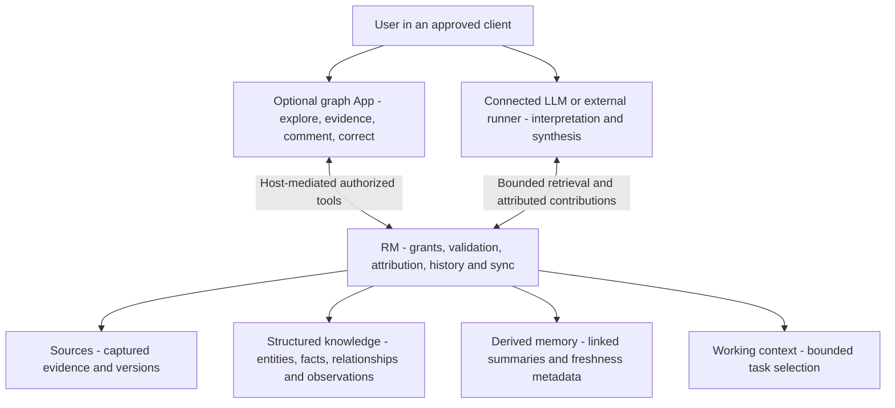

# Personal v1 architecture

**Selected exploration direction, 10 November 2026:** [A26](ADRS.md#a26-answer-focused-relationship-briefs) and [the relationship-brief contract](RELATIONSHIP-BRIEF.md) add a bounded, client-prepared answer over existing derived artifacts. RM validates named graph paths and pinned input freshness; the App presents grouped records, the shared field editor and a small selected path. Client interpretation never becomes an independently verified claim. See [qualification](RELATIONSHIP-BRIEF-VALIDATION.md) for executed evidence and deployment boundaries.

**Current implementation boundary:** [A25](ADRS.md#a25-contract-driven-editor-and-controlled-two-peer-rollout) and [the editor/rollout plan](FIELD-EDITOR-ROLLOUT.md) specify a bounded core field projection, a discovered extension of existing correction semantics, shared catalog-driven controls and a coordinated two-peer rollout. These reuse the current journal, grants and tools. No second data service, internal model or production bypass is introduced.

**Client-led implementation, 9 November 2026:** The journal-backed workspace tools, pinned briefs, client task checkpoints and optional graph App are implemented in this branch. See [the workspace guide](CLIENT-LED-WORKSPACE.md) and [executed qualification](CLIENT-LED-VALIDATION.md). Historical requirements-only notes below describe their earlier documentation revision; named provider products still require separate live qualification.

**Design clarification, 9 November 2026:** [A22/A23](ADRS.md#a22-client-led-processing-and-provider-independent-memory-roles) and [L01–L08](PRD.md#client-led-processing-and-review-direction) select client-led model processing, four memory roles, contributor attribution and the next graph-review interface. This requirements-only update does not refresh the historical deployment/qualification statements below or claim the new features are running.

**Accepted deployment direction, 7 November 2026:** a normally available NAS-hosted Linux peer plus an independently writable Mac peer. The graph engine and NAS/OAuth/automatic-sync extension are implemented under [NAS-CONTRACT.md](NAS-CONTRACT.md). [Acceptance evidence](ACCEPTANCE-RESULTS.md) separates executed local checks from earlier baseline results and untested owner-device/provider deployment.

DSM and existing NAS services remain on the main LAN. The workload gets a separate identity and isolated VLAN, preferably in a small Linux VM with hardened containers. Public MCP and private synchronization use separate TLS listeners over the same local Store. Cloudflare is an optional outbound tunnel only. It does not hold the knowledge database, and there is no Workers/Durable Objects data port in this release. Primary endpoint does not confer sole-writer or owner authority.

The [editable diagram](diagrams/personal-v1.mmd) contains no private endpoint or secret. OAuth uses a maintained authorization server with a strictly validated resource-server adapter and current local agent grants. Full personal-store read access is authorized independently for each app/API connection. A container bridge alone is not proof of LAN isolation; effective VLAN, host and IPv6 rules must be verified on the NAS. See [deployment](NAS-DEPLOYMENT.md) and [maintenance access](REMOTE-ADMIN.md).

## Knowledge contract

Stable entity IDs represent identities. Assertions represent sourced facts and typed relationships; changing names or affiliations are assertions, not destructive identity edits. Preserve unresolved observations without inventing entities or dates. Evidence identifies the source and captured version. Separate direct source statements, extraction, model inference and review attribution.

World time describes when a claim held. Knowledge time describes when a specific peer acquired/applied the claim or correction. Retain origin metadata separately from each peer's receipt/application history. Queries name a local knowledge position or shared causally closed frontier. At a shared frontier, semantic answers converge; the peers' earlier local-known histories may differ. Unknown dates are not sortable sentinel values, and half-open interval/precision rules must be consistent across search and traversal.

Correction, retraction, invalidation and reinstatement are distinct semantic operations. Competing sources are not automatically revisions of one claim. Concurrent revisions retain branches until an authorized resolution. Administrative deletion and physical erasure are separate from changing a historical belief. Return evidence, lineage, unresolved alternatives, temporal fidelity and coverage with answers. Derived indexes and summaries never become a second source of truth.

## Core field contract and focused CRUD

[A24](ADRS.md#a24-core-field-contract-and-focused-memory-crud) and [the core field contract](CORE-FIELD-CONTRACT.md) extend the existing type/predicate registry with shared fields, types/cardinality, requiredness, applicability and missing-state semantics. The starter catalog, discovery, explicitly tagged validation and shared editor are implemented under [the client contract](RM-CLIENT-CONTRACT.md). The private two-peer rollout has separate [execution evidence](FIELD-EDITOR-VALIDATION.md#private-rollout-observation); universal field activation is not enabled. Every newly governed write path must use core validation; MCP App forms, models, CLI/import adapters and peers cannot define competing semantics. Catalog changes use a controlled versioned rollout on both peers.

Fields remain sourced assertions over immutable identities, with per-value evidence, temporal precision, conflicts and correction history. Not recorded, explicitly unknown and not applicable differ; withheld/partial views do not establish absence. Preserve the existing omitted-end/explicit-null time contract and prevent blank controls from inventing ongoing validity. Retraction, ended validity, archive and permanent erasure retain distinct meanings.

The App is a focused graph/list explorer and CRUD editor over the same authenticated tools. Search-result actions, inline forms and expanded views reuse core definitions. Empty optional-field visibility and themes are presentation only. RM has no internal conversation, assistant/composer, model selector or task dashboard; surrounding chat belongs to the host. See [editor qualification](FIELD-EDITOR-VALIDATION.md) for focused implemented checks; the complete FC01–FC08 matrix and named hosts remain separate.

## Client-led processing and memory roles

Connected applications and authorized external runners do the model work. RM supplies bounded authorized evidence, validates submitted records and preserves attribution, history and sync. It does not need an embedded model, provider API key or autonomous inference service. Target ChatGPT/Codex, Claude Chat/Cowork/Code, Gemini, Grok, local-model hosts/runners, Praxis and further compatible clients; each actual product connection must be qualified independently.

The [editable processing diagram](diagrams/client-led-memory.mmd) is a responsibility plan, separate from the deployment diagram above. Source/graph storage and bounded retrieval are implemented foundations. A portable graph App, durable comments, consistent contributor activity, maintained-summary freshness and richer context assembly still need implementation/qualification; drawing them does not establish them. The four roles share the graph/evidence contract and do not require separate databases or define confidence levels.

The client controls model execution and data submission. A selected graph view should expose only the task-relevant context to its host model, not transmit the whole corpus. All clients and the App use the same authoritative tools; UI code has no direct database, owner, peer or maintenance authority. When no approved client/runner is active, work remains explicitly incomplete. Do not depend on deprecated MCP sampling or assume an existing connection permits unattended jobs.

For each contribution, distinguish requester, authenticated connection/grant, reported product/processor/model, method/job identity, input records/revisions/frontier, output IDs/action, admission/replication outcome and actual review. Trust authority established during admission; mark unknown or client-reported metadata honestly. A display line such as “suggested by this connection” must expand to evidence and history without inventing owner verification. Current provenance is a foundation; A23 defines the additional consistent contract and review experience to implement.

Generated summaries retain their inputs and never overwrite canonical claims. Changed/corrected inputs require visible stale or unassessed freshness. User corrections append semantic actions; existing comments reference specific identities/claims/revisions. Per-claim review, concurrent branches and current permissions remain effective across clients and peer sync. Under A24 the ordinary interface is search, graph/list exploration, evidence, CRUD and history; comments/jobs remain compatible capabilities rather than mandatory navigation. Provider machinery is not an end-user setup prerequisite.

## Durable operation and personal sync

An admitted semantic operation group and its required local metadata become durable before acknowledgment and visible atomically. Received operations wait for required dependencies. Use stable operation identities and safe retries. Clock skew, duplicate delivery and delivery order must not silently discard a correction.

Peers authenticate each other and operate within the owner's admitted store. The `sync-watch` runner exchanges bounded batches using durable frontiers, an exclusive runner lock, persisted retry deadlines, interruptible waits and explicit incomplete/paused status. `serve-nas` separates OAuth MCP from private peer TLS; configured capacity guards refuse graph writes while preserving reads. Tests cover offline writes on both, concurrent corrections, interrupted exchange, missing dependencies, stale rejoin, restart and restore. A successful two-peer test does not establish a transitive relay mesh. Fine-grained subscriptions and larger meshes are separate later choices.

## Import and migration

V1 supports Markdown/Logseq and prior LivingAtlas data. First inventory the actual generations and available artifacts without altering originals. Define explicit conversions for source identity, original world/knowledge semantics, evidence, correction lineage, IDs or ID mappings, and import-time knowledge. Do not backdate when RefactoredMemory itself learned imported material.

Unchanged reimports are idempotent; changed source versions preserve earlier evidence and use declared correction/update rules. Inventory every input with imported, unchanged, unsupported, quarantined or failed status. Preserve unresolved content and fidelity gaps rather than guessing equivalence or silently skipping it. Keep an original backup, versioned mappings and a rollback path.

Legacy decryption support is an import compatibility concern when an existing source is encrypted. Use only authorized original keys in the approved environment. It does not require a new v1 encryption architecture. Missing artifacts or keys remain explicit blockers for the affected migration path; development uses synthetic fixtures until real-data access is separately authorized.

## Personal protection and later evolution

V1 requires local access controls, scoped MCP client/agent grants, authenticated peers, HTTPS/TLS for remote transport, bounded inputs/queries, and safe logs. Source text cannot grant permissions or execute tools. Current authority applies to historical queries. Model-inferred additions are automatically accepted within configured client/agent grants, without per-item human review. Preserve evidence, actor/model/derivation attribution, uncertainty, conflicts and correction history; acceptance is not human verification or established truth. Q7 authorizes proactive client capture within grants. Q8 prefers explicit authenticated owner corrections while retaining contradictory claims and evidence. Q9 established MCP and CLI first; A23 adds the graph-review direction. Q10 requires the project-decision, relationship-evidence and recent-changes journeys.

Product content encryption, corporate ownership boundaries and multitenancy are deferred. Stable IDs, versioned semantic contracts, provenance and portable export preserve a practical migration path. Future tenancy/custody must not introduce a prerequisite enterprise framework into personal v1.
