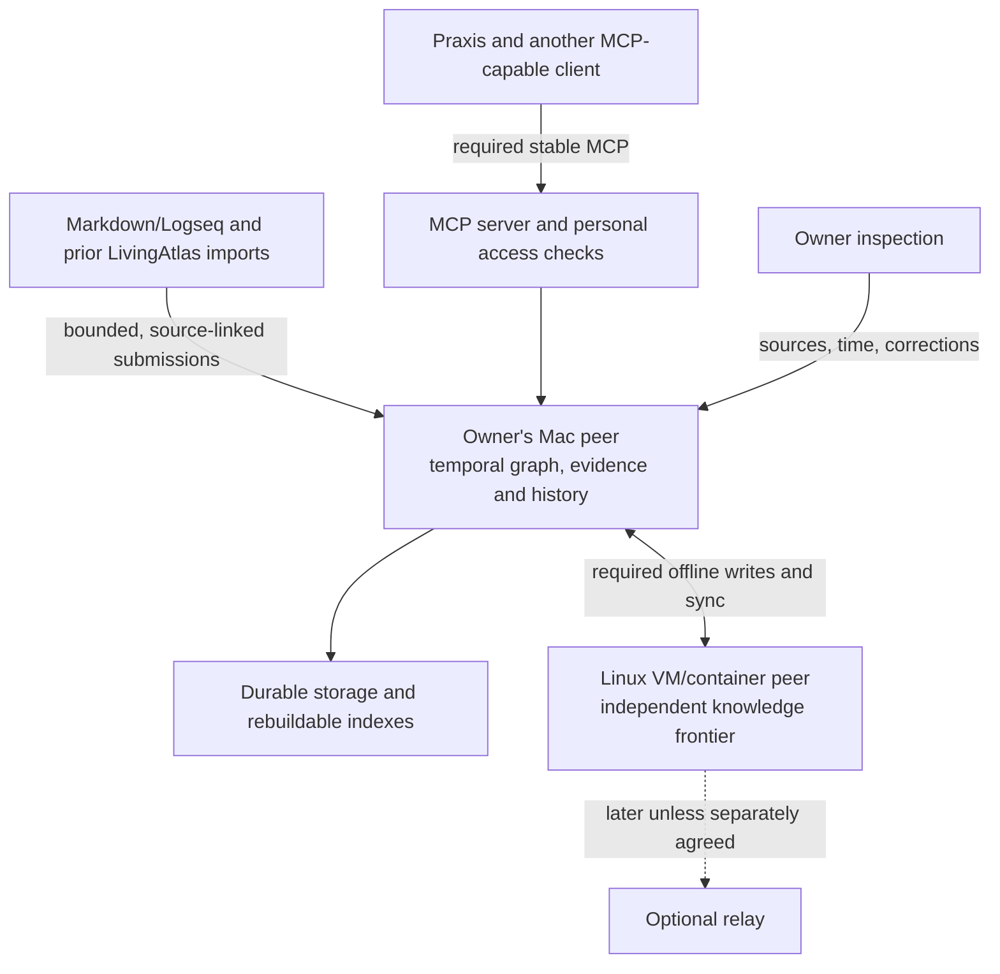

# RefactoredMemory Product Requirements

**Status:** Draft 0.10 for owner review. **Revised:** 7 November 2026. **Product owner:** the owner. **Confirmed release scope:** RefactoredMemory v1 is the owner's personal knowledge store. Multi-tenancy, personal versus corporate/multiple-corporate ownership, and product-level content encryption are later phases. This repository PRD is authoritative; the historical planning Page is reconciled through authorized access. Research and documentation continue; implementation waits for the owner's explicit **“proceed”**.

RefactoredMemory v1 is a **single-owner personal temporal knowledge store**: stable entities connected by sourced assertions and relationships whose world time and knowledge history remain distinct. It must integrate through the latest published stable MCP standard with Praxis and other MCP-capable LLM clients. **The owner's Mac and a Linux VM/container must both support offline writes and synchronization in v1.** Both belong to the same personal owner; this does not imply multi-tenancy. Day-one input includes explicit MCP capture, a bounded **Markdown/Logseq importer**, and **import/migration of data from previous LivingAtlas runs**. Inventory the available source layouts and prior store/run generations during research; those are evidence and compatibility tasks, not an open choice about v1 inclusion. Model-inferred additions may be accepted automatically within configured client/agent grants, without per-item human review; acceptance preserves provenance and uncertainty and does not mean human verification or established truth.

V1 prioritizes the owner's useful personal MCP capture, initial Markdown/Logseq and prior-LivingAtlas-run import, retrieval, correction, provenance and history workflows, with operational simplicity and open technology choices. A personal store can contain knowledge about organizations without implementing corporate tenants or corporate data ownership. Local, on-premises, SaaS and hybrid growth, multi-tenant/multi-corporate ownership, and encrypted product profiles remain later roadmap targets. Preserve extension paths without making their implementation or policy qualification a v1 dependency.

The [architecture decisions](ADRS.md) describe proposed choices. The [research ledger](RESEARCH.md) summarizes reviewed sources, the supplied M5 Max Atlas/SQLite selective-read result and qualification gaps. The full historical evaluation and its separate reference experiments remain in the authorized planning source; they are not reproduced in that summary. A synthetic-data plaintext development profile supports initial proofs; sensitive-data rollout and public exposure are separate decisions. RefactoredMemory uses the existing repository and selected cloud environment; Atlas/LivingAtlas identify historical sources and predecessor contracts. Development, tests and demonstrations use synthetic data only unless the owner explicitly approves otherwise. The personal-store goal is not approval to ingest real personal data.

# Small useful core

V1 has four required responsibilities, which may share one small process on each personal peer:

1. **Temporal graph:** entities, immutable assertions, typed relationships, evidence and correction lineage, with separate world and knowledge time. Explicit MCP capture and the Markdown/Logseq and prior-LivingAtlas-run importer enter this same semantic boundary; import does not bypass provenance or the confirmed automatic-acceptance policy within configured client/agent grants.

2. **Local persistence and queries:** durable graph writes, temporal reads, bounded traversal, timeline/history and text search. Local indexes are derived from the graph history.

3. **Personal-device replication:** exchange graph operations and dependencies between two of the owner's admitted peers, preserve offline writes and concurrent changes, recover from interruption, and expose each answering peer's knowledge frontier.

4. **MCP and inspection:** a required MCP server over the same authenticated graph API, usable from Praxis and at least one independent MCP client, with source, time, history, conflicts and the currently enforced personal-owner/client grants inspectable. Q9 will decide whether v1 inspection stays MCP/CLI-only or includes a small browser interface; no option is selected yet.

Each personal peer should be packageable as one process with a local temporal graph and derived views. Implementation runtime, language and persistence remain open to evidence from eligible relational, native graph, Datalog, temporal-history and replication-oriented approaches. Q1/Q2 confirm two personal offline-writable peers: the owner's Mac and a Linux VM/container. Exact Linux host provisioning and environment-specific setup remain separate implementation/setup details and are not authorized by this documentation choice. A separate model runtime, graph server, broker, tenant platform or corporate policy engine is not required for v1.

The first useful outcome is: from Praxis or another supported MCP client, save a sourced personal fact or relationship, retrieve it with evidence and independent world/knowledge time, correct it while the other personal peer is disconnected, reconnect, and obtain converged temporal history without rewriting what either peer previously knew. Concurrent offline corrections remain visible, and restart/restore preserves acknowledged work. Synthetic Markdown/Logseq and historical LivingAtlas-format fixtures must produce inspectable source-linked records, preserve original time/correction lineage and identity or explicit mappings, tolerate repeat imports without duplication, and handle source updates through documented version/correction semantics.

# Temporal graph semantics

| Element | Minimum meaning |
| --- | --- |
| Entity | A stable opaque identity for a person, organization, project or other supported type. Names, roles and changing attributes are sourced assertions, rather than a mutable bag of facts inside the entity. Authentication identities are separate. |
| Fact assertion | One typed statement about an entity, with its own identity, predicate, value, evidence, provenance, world-time expression and knowledge lineage. |
| Relationship assertion | A first-class assertion with a subject, registered predicate and target entity. Its valid interval, evidence and lineage determine whether an edge appears in a temporal graph view. |
| Observation | A bounded sourced statement whose meaning cannot yet be safely structured. It remains explicitly unresolved; it does not invent an entity, date or relationship. |
| Evidence | An immutable bounded source reference or captured excerpt/snapshot, with source identity, capture metadata and links that support, contradict or contextualize an assertion. |
| Lineage | New assertion records that correct, retract, invalidate or reinstate earlier assertions. Prior meanings remain readable through knowledge-history queries. |

The initial predicate registry needs only the types and cardinality rules used by the first fixtures. Validate entity references, typed values and relationship endpoints. Preserve unsupported material as a labelled observation or opaque import record; an unknown predicate or action must not silently become an affirmed edge. A universal ontology and automatic identity merging can follow.

**World time** describes when the claim holds in the world. State relationships use half-open intervals. Precision, approximation and unknown time remain explicit; unknown is never a sortable sentinel date. The existing contract's absent end means ongoing, which is different from an explicitly unknown end. Untimed material may be stored, but a date-filtered answer must report it as temporally unresolved rather than asserting a match. Full recurrence/calendar interpretation is deferred.

**Knowledge time** describes when a particular RefactoredMemory view acquired a claim or correction. Preserve origin commit metadata separately from each replica's receipt and causal-application history. A local knowledge position provides an unambiguous order even when wall clocks skew. A historical mesh query names a replica and knowledge position, or an explicit causally closed frontier. A timestamp form must resolve within that named replica's retained history; an unqualified global known-at timestamp is not defined.

These axes are part of the core even when a world date is unknown. A query may independently select valid-at world time and known-at knowledge state. Every query returns its namespace, answering replica, applied frontier, temporal match quality, unresolved branches and coverage limits. A missing claim on a disconnected peer is not proof that it is false.

**Correction actions have distinct meanings.** Correct replaces an erroneous recording with a new assertion. Retract says the earlier belief was mistaken; it does not invent a world event ending the relationship. Invalidate says a relationship held and then ended, retaining its earlier valid interval. Reinstate affirms previously retracted knowledge again. Each action names its predecessors and retains its source and reason. Ordinary administrative tombstones are separate from these semantic actions.

Two independently sourced claims can disagree without being revisions of one assertion. Preserve both and show alternatives; a predicate's declared exclusivity can mark a dispute. Conversely, concurrent corrections of the same lineage are replication branches. Neither case permits a clock-based winner, an invented blended fact or duplicated corroboration from copying a claim between peers.

## A concrete temporal example

All names and facts here are synthetic. On 10 January, peer A records that Rae works for Northstar, valid from 1 January with an ongoing end. On 5 February, it learns that the relationship ended on 1 February and appends an invalidation. On 10 February, better evidence corrects the end to 28 January.

| World question | Knowledge view on A | Answer |
| --- | --- | --- |
| Did the relationship hold on 15 January? | After the 5 February invalidation | Yes, within the retained valid interval. |
| Did it hold on 31 January? | After 5 February, before the correction | Yes, under the end date then known. |
| Did it hold on 31 January? | After the 10 February correction | No, under the corrected interval. The earlier belief is still readable. |
| What did peer B know before it received that correction? | B's own earlier knowledge position | B's prior view, labelled with its frontier. B must not backdate local knowledge to A's commit. |

If the original employment claim was instead a mistaken extraction, a retraction removes it from affirmed graph views after that knowledge action, including queries about earlier world dates. The graph can still show that it was believed before the retraction. Graph traversal, assertion lookup and text search must apply the same lineage and temporal rules.

These semantics extend the existing [canonical knowledge records](https://github.com/ProvisioInsights/LivingAtlas/blob/e36ebe821eafb3fc00093b6afcc2c4c6e0c4c30d/docs/architecture/adr-0004-canonical-knowledge-records.md) and [assertion lineage](https://github.com/ProvisioInsights/LivingAtlas/blob/e36ebe821eafb3fc00093b6afcc2c4c6e0c4c30d/docs/architecture/adr-0005-assertion-lineage-and-evidence.md). The new replica-scoped knowledge contract is proposed; it must be versioned rather than silently changing the published single-writer API.

# Decisions and defaults

The owner has confirmed personal knowledge storage, two personal offline-writable peers on the owner's Mac and a Linux VM/container, and MCP plus Markdown/Logseq and previous-LivingAtlas-run import as v1. Temporal semantics, operational simplicity, source-linked memory, open technology choice and mandatory latest-stable MCP integration remain core. Multi-tenancy, corporate versus personal ownership and product content encryption are later work. Basic personal-owner/client authority and transport protections remain in v1. Q6 confirms automatic acceptance of inferred additions within configured client/agent grants; no per-item human review is required. Followups Q7–Q10 on capture triggers, preferred-claim handling, inspection surface and day-one tasks remain unanswered. Source locations, layouts and historical store generations are research evidence/compatibility tasks.

| ID | Material question | Status or confirmed direction | Consequence |
| --- | --- | --- | --- |
| Q1 | One primary personal store, or two personal devices that can independently write offline and synchronize? | Confirmed: two personal peers with offline writes and synchronization are required in v1. | Include causal delivery, offline/concurrent corrections, reconnect, convergence and recovery. Both peers belong to the same personal owner; corporate tenants are not implied. |
| Q2 | Which initial runtime(s) and connection arrangement should v1 qualify? | Confirmed: the owner's Mac plus a Linux VM/container. | Qualify both OS/runtime environments with synthetic data. Exact Linux host provisioning and connection configuration are setup details; no new host, external deployment or real-data use is authorized by this selection. |
| Q3 | When organizations are supported later, does each retain its own data after departure while the person retains personal data? | Ownership principle previously confirmed; corporate implementation deferred beyond v1. | Corporate tenancy, memberships, offboarding, mixed-source classification and recovery are later requirements. |
| Q4 | Who can recover encrypted personal data and what happens if all recovery factors are lost? | Deferred with product content encryption. | A future protection profile must resolve custody/recovery and its trust assumptions; it does not block personal-store v1. |
| Q5 | Which initial inputs must v1 support? | Confirmed: MCP capture, Markdown/Logseq, and data from previous LivingAtlas runs. | Inventory available source layouts and historical run/store generations; preserve identity/mappings, sources, provenance, world/knowledge time and correction lineage. Require idempotency, update semantics, visible accounting and safe source boundaries. Real-data ingestion and use of original decryption keys remain separately authorized. |
| Q6 | Do inferred additions wait for review or enter under a configured automatic-write grant? | Confirmed: automatic acceptance within configured client/agent grants, without per-item human review. | Preserve source/evidence, actor/model/derivation attribution, uncertainty, correction history and conflicts. Acceptance is not human verification or established truth; source text cannot grant authority. |
| Q7 | Should clients proactively capture useful knowledge or write only on explicit requests? | Pending followup; no default selected. | Automatic acceptance in Q6 does not settle the capture trigger or broaden a grant. |
| Q8 | When claims conflict, should explicit human corrections receive preference or should there be no preferred claim? | Pending followup; no default selected. | All alternatives, evidence and history remain retained under either policy. |
| Q9 | Is v1 inspection MCP/CLI only or should it include a small browser inspection UI? | Pending followup; no default selected. | Required inspectability remains; the concrete owner-facing surface is to be decided. |
| Q10 | Which three concrete day-one questions/tasks must v1 make useful? | Pending owner examples. | Use these tasks to sharpen acceptance fixtures and retrieval outcomes. |

Q1's two personal offline-writable peers, Q2's Mac plus Linux VM/container, and Q5's Markdown/Logseq plus prior-LivingAtlas-run import are confirmed. Q6 automatic acceptance within configured client/agent grants is confirmed; Q7–Q10 remain unanswered product followups, and source artifact locations/generations are research evidence to establish. Q3 is retained as a confirmed later ownership principle; Q4, protected execution, corporate lifecycle and mixed-domain policies belong to later phases. Language and storage remain unselected. Updating this scope does not authorize implementation; reconcile the documents after answers and wait for an explicit “proceed.”

V1 does not require corporate tenants, employer lifecycle, product content encryption/key custody, continuous automatic ingestion, background AI, advanced identity federation, recurrence solvers, vector retrieval or maintained-decision automation. Q5 requires bounded Markdown/Logseq import and migration of prior LivingAtlas-run data; inventory actual source layouts/store generations and record compatibility gaps. Q6 permits inferred additions to be accepted automatically within configured client/agent grants, with no per-item human review. Whether clients proactively capture useful knowledge remains Q7. Temporal graph reads, evidence, correction lineage, basic time precision, personal access controls and working MCP integration remain core. Any new research prototype requires separate authorization before the implementation gate.

The earlier offline-interpretation question is superseded for the core: interpretation is an optional client. No hosted AI or paid processing follows from synchronization.

# Deployment topologies

| Topology | What it does | Offline behavior | Release position |
| --- | --- | --- | --- |
| One personal peer | Stores/queries the owner's graph and serves authorized MCP clients. | Local reads/writes continue. | The building block on each of v1's two peers; not the complete v1 delivery by itself. |
| Two personal writable peers | The owner's Mac and a Linux VM/container each store history and commit local changes. | Local reads/writes continue; views may differ until synchronization. | Confirmed v1 requirement under Q1/Q2. |
| Optional relay | Receives/forwards retained changes so personal peers need not be simultaneously reachable. | Delivery waits for an authorized path. | Later unless separately agreed. |
| Transitive personal mesh | Admitted peers/relays forward operations and converge. | Eventual convergence under the declared delivery/admission model. | Separately qualified later; direct two-peer sync does not establish it. |
| Multi-tenant/corporate shared service | Distinct personal and organization ownership domains, memberships and policies. | Depends on its later architecture. | Deferred beyond v1. |

The two personal peers need durable storage and a qualified implementation runtime on the owner's Mac and a Linux VM/container. The exact Linux host, packaging and connection configuration remain setup details; this scope selection does not provision a host or authorize external deployment. Windows, browser-hosted storage, mobile full peers and hosted multi-tenant services are not v1 claims.

Cloudflare Workers can be a later relay or bounded remote endpoint backed by an appropriate storage adapter. Treating it as a full peer needs its own persistence, execution and query proof. Do not copy a desktop filesystem design into a Worker.

Configure a small set of endpoints explicitly. Automatic discovery, NAT traversal, global membership consensus and unrestricted federation are outside the core.

# V1 personal-device sync and conflict contract

Two personal offline-writable peers are required in v1 under confirmed Q1. Replicate **temporal graph operations**, rather than database files or only the current entity/edge view. Each full peer stores its own graph history. A shared network folder or ordinary file-sync service is not the synchronization protocol. Relay/transitive mesh is separately scoped later.

Every graph operation has a stable opaque ID, namespace, schema version, origin peer/incarnation/sequence, causal dependencies and a versioned payload representation. Assertion identity and supersedes links identify semantic lineage; transport parent/dependency links provide causal delivery. Both must be preserved. Authoritative origin attribution comes from authenticated admission, not a caller-supplied name.

New assertions and relationships are immutable semantic events. Corrections, retractions, invalidations and reinstatements append new assertions naming predecessors. Local projections of active heads or supersession are rebuildable; a replicated single mutable superseded-at field cannot decide between concurrent branches. Wall-clock timestamps describe origin/local events and never choose truth or a winning branch.

Distinct additions coexist; duplicate delivery of one operation has no second effect. Claims with different assertion identities retain their own provenance, even when their content resembles another claim. A semantic dispute between sources is distinct from concurrent descendants of one lineage. A resolution appends a sourced action referencing all predecessor heads considered by that authorized resolution, can retain uncertainty, and can be reopened by a newly discovered branch. Search and traversal expose unresolved alternatives rather than silently taking a default winner.

Administrative deletes are tombstones, separate from belief retraction or world invalidation. A concurrent delete/edit is visible, and a stale peer cannot silently resurrect deleted availability. No physical purge or source-history erasure follows from correction. Retain required deletion/causal metadata; retired or too-stale peers may need a verified snapshot reseed.

Sync exchanges bounded summaries/checkpoints, missing operations and their required entities, assertion predecessors and evidence. Validate identity, namespace, schema and causal dependencies before exposing an operation as graph state. Durably received progress is separate from causally applied progress. Checkpoints cannot skip sequence gaps; missing dependencies remain visible. Only a complete admitted graph-operation group becomes query-visible.

Repeated delivery, response loss and routing through another peer are idempotent. Reject contradictory logical contents under the same operation ID. A restored or cloned directory must use controlled rejoin or a fresh peer identity/incarnation, rather than reusing an active origin sequence stream.

Convergence means peers with the same admitted operations, semantic contract and chosen knowledge frontier derive the same assertions, graph edges, lineage branches, tombstones and temporal answers. Receipt histories can differ, so each peer's past local knowledge remains distinct. Disconnection does not provide instant global consistency.

# Later roadmap: ownership and protected processing

**Outside v1:** multi-tenancy, corporate/multiple-corporate ownership, and product content encryption. The following is retained future direction, not an initial schema, acceptance or policy prerequisite. The long-term target is a temporal knowledge graph whose protected plaintext is available only to its controlling owner and approved people or processing actions across personal, organization, local, on-premises, SaaS and hybrid use. No cryptographic mechanism or production guarantee is accepted by that direction.

## Later personal and organization domains

A later multi-owner model distinguishes controlling owner domain, tenant, creator, subject, source, actor, membership and deployment custodian. A person may have a personal domain and memberships in several organizations. V1 has one personal owner; graph facts about a person or company do not create corporate tenants, memberships or authentication grants.

Trusted workspace/connector configuration can set an approved owner domain. Ambiguous material is unassigned/quarantined; ordinary source text or inferred employment cannot transfer ownership or grant access. Cross-domain identity links, exports/transfers and persistent mixed-source results require explicit authority. Default separation is personal versus each employer, rather than a global personal/work boolean.

The owner confirmed Q3's ownership principle on 7 November 2026: the organization retains control of its own data after someone leaves, and the person retains their personal data. Recovery authorities, offboarding grants and administrator/read roles remain proposed policy choices. An admin role does not automatically imply read permission, but an authority able to change key-release policy is part of the trust model. Ambiguous ownership, mixed-source and derived-data treatment, and applicable legal/contractual obligations require separate resolution.

## Personal grants now; delegated protection later

V1 distinguishes the personal owner/authorizer from acting clients or agents and enforces authorized read/write operations. Q6 permits automatic acceptance of model-inferred additions within a configured client/agent grant, without per-item human review. Retain source/evidence, actor/model/derivation attribution, uncertainty, correction history and conflicting claims. Acceptance records an admitted assertion, not human verification or established truth. Q7 still determines capture triggers; source content cannot create or widen a grant. A read grant does not imply export, source deletion or broader model/provider processing. Later grants may add corporate policies, attenuated delegation, key scope, execution profiles and cross-domain output restrictions.

The selected executor needs both permission and a legitimate way to obtain the relevant plaintext. Approving an agent on an ordinary provider-controlled server does not make that server's operators blind. Operator-blind storage plus owner/customer compute, or a separately qualified protected execution profile, are candidate approaches. An external model receiving plaintext is an additional processing destination requiring approval.

Dataset-wide key access cannot enforce a narrower item-only grant against an untrusted agent. Future key granularity, trusted mediation and output enforcement must match advertised scope. V1 uses ordinary personal-owner/client authorization and does not implement delegated keys, organization ownership domains or a corporate policy engine.

## Later privacy and lifecycle semantics

The target profile must document operator, executor, endpoint, code-update and metadata trust assumptions. Encryption at rest or customer-managed keys are insufficient if the operator can invoke decryption or replace the code receiving plaintext. Key custody, personal recovery, organization recovery and data availability are explicit design choices; account reset is not equivalent to recovering a missing data key.

Use current authorization when answering historical valid-at/known-at queries. Employment history never restores former access. Revocation has a declared propagation/offline/key-residency bound; it cannot recall plaintext already disclosed to a recipient. Future erasure covers derived indexes, embeddings, summaries, caches, logs, temporary files, replicas and backups. Restores reconcile current policy and deletion/retention state before serving.

Derived data retains source restrictions and lineage. Mixed personal/organization reasoning requires both domains to approve the executor and use; saving its result additionally requires an authorized destination. Proposed default: no persistent combined artifact without that authority. A semantic retraction or relationship ending is distinct from privacy erasure; an authorized purge can make retained history unavailable, which queries must report.

## Now and later

**Now:** personal-owner/client authority, current access checks on historical reads, provenance, safe credentials and logs, durable local recovery, and appropriate transport protections. **Later:** C22/M17 corporate ownership/isolation, E07–E11 enterprise protection and lifecycle features, and P01–P06 encrypted/protected-profile qualification. C23/M18 retain only their ordinary personal-access requirements in v1. Product-level content encryption and corporate key recovery are not v1 gates. All development/test fixtures remain synthetic unless explicitly approved otherwise.

Before a later encrypted or corporate profile is advertised, choose its custody/recovery, execution/leakage and ownership policies and qualify the applicable future gates. Tenant count, cross-domain fan-out, protected traversal and cryptographic revocation measurements belong there. V1 still qualifies the basic personal access, data handling and transport protections it actually claims.

## Future protection qualification gates

These are proposed gates before advertising the relevant protected-data profile; none has been run or passed by this documentation work.

| Gate | Required evidence |
| --- | --- |
| P01 Operator and key boundary | Under the declared threat model, storage/ordinary operator roles cannot obtain protected payloads or silently replace the approved key-release/executor path. Include client/update, metadata, index, log, temporary and backup surfaces. |
| P02 Delegated processing | Lookup/cleanup grants enforce resources, actions, audience/profile, expiry, egress and onward-delegation limits. Negative tests deny export, destructive cleanup, transfer and external model use when unapproved. |
| P03 Owner lifecycle | Personal/two-employer fixtures enforce membership, organization recovery/offboarding policy and explicit transfers without personal-domain access. Current authority also governs historical reads and cross-domain joins. |
| P04 Recovery and revocation | Exercise the selected personal/org recovery roles, lost device/factors and compromised keys. Measure grant/key-cache expiry, offline revocation bounds and controlled rejoin; identify prior disclosures that cannot be recalled. |
| P05 Derivation erasure and restore | Invalidate/purge affected indexes, embeddings, summaries, caches and permitted backup/key copies; enforce holds/retention and current deletion policy after restore. Report unavailable history and unrecallable exports honestly. |
| P06 Privacy and scale cost | Measure end-to-end protected query/index/model/output work, key/policy overhead, tenant/domain fan-out, history growth, revocation/erasure backlog and recovery under the actual selected hardware/trust profile. Plaintext read timings cannot substitute. |

# V1 personal identity and trust boundaries

V1 has one personal owner and explicitly authorized human/client/agent principals. Distinguish the owner, acting principal, graph entity/subject, creator and source without implementing corporate tenants or employer memberships. A graph statement about employment or an organization cannot change authentication or authority. Retain stable IDs and versioned contracts as extension paths; do not prebuild the later corporate ownership model.

Ordinary knowledge writes cannot grant rights, enroll peers or change access policy. Apply current personal-owner/client grants to historical as well as current queries and to any enabled export or write destination. Filter unauthorized data before retrieval output, counts or derived persistence. Each personal peer has explicit admission and scope; cross-corporate isolation belongs to the later multi-tenant phase.

A full plaintext replica can read its bytes. API filters alone do not make it blind or enforce item-only access after it receives a dataset-wide key. Future scope/key granularity or trusted mediation must match the advertised grant. A provider-controlled plaintext executor is part of the trust boundary even when it runs an approved agent.

Authenticate the two personal endpoints and operation origins. A relay login is not proof of the original writer if relaying is added later. Use an established qualified mechanism for the agreed direct two-peer exchange. Future blind relays and protected executors are deferred with the encrypted profile.

V1 enforces revoked local client grants and avoids restoring obsolete access through an old snapshot. Document policy propagation limitations across the two offline personal peers. Cryptographic revocation, organization authority, corporate offboarding and key recovery remain later work; no instantaneous erasure of previously disclosed plaintext is promised.

# V1 access protections and deferred content encryption

Product-level content encryption, delegated keys, custody/recovery and operator-blind execution are deferred beyond v1. The later goal remains protected payloads available only to the controlling owner or approved processing contexts under a declared threat model. This deferral does not remove basic authentication, client/agent grants, local filesystem/access controls, safe credentials, or transport security.

V1 development/tests use a named **synthetic plaintext development** profile. This is a test profile for a personal knowledge-store product, not a claim of encrypted storage or operator blindness. Any actual personal-data import/use needs separate owner approval of the real storage/processing environment; the present update neither imports data nor opens a public endpoint. Later encryption cannot erase earlier plaintext copies.

Retain authenticated clients, bounded requests, redacted logs and protected cross-host transport such as HTTPS for remote MCP. Use local process/filesystem controls for stdio. Authenticate the two admitted personal peers. Preserve logical graph identity, provenance and versioned interfaces so a later encryption migration can preserve meaning; do not require key-policy envelopes, multiple-owner schemas or confidential-computing machinery in v1.

Candidate protected profiles include encrypted storage with owner/customer-side processing, organization-controlled execution, and separately qualified protected remote execution. Ordinary hosted plaintext processing is a different trust profile, not equivalent privacy. A browser/client update channel, external model endpoint, debug log, plaintext index and recovery path all belong in the chosen threat model.

Later protected deployments must choose owner-specific custody/recovery, trusted executors and permitted metadata and qualify the relevant P01–P06 gates. These gates do not block personal-store v1. Real personal-data use still needs explicit approval of its actual plaintext/storage/processing limits, and external deployment is a separate action. No encrypted production profile is accepted by this document.

# Core requirements

C01–C24 retain stable requirement IDs but distinguish required personal graph/sync/MCP/import behavior and later corporate scope. M01–M19 use the same scope classification. C22/M17 and P01–P06 are deferred; C23/M18 cover basic personal authority now. V1 must include two personal offline-writable peers and MCP interoperability under C24/M19 and initial import under C14/M11. No tests are claimed as executed by this documentation update.

| ID | Requirement | Release scope and evidence |
| --- | --- | --- |
| C01 | Stable entity identities and schema-versioned facts, relationships, bounded unresolved observations and evidence; validate predicate/value/endpoint types. | V1: M01, M13. |
| C02 | Commit semantic operations and sync eligibility durably before acknowledgment; recover without losing acknowledged work or exposing partial groups. | V1: M01, M06. |
| C03 | Both admitted personal peers read/write their authorized personal graph while disconnected, with local knowledge frontier and staleness visible. | V1, Q1 confirmed: M03. |
| C04 | Exchange bounded missing graph operations and required entities/evidence/predecessors with durable progress, duplicate detection, causal dependencies and restart-safe identity/epochs. | V1: M03, M05, M06. |
| C05 | Preserve concurrent lineage heads in reads/search/traversal; resolve by sourced action naming the predecessor heads considered; no wall-clock truth winner. | V1: M04, M15. |
| C06 | Keep administrative tombstone/restore separate from retract/invalidate; expose delete/edit conflicts and prevent stale-peer resurrection. | V1: M07, M14. |
| C07 | Entity/assertion reads, valid-at and replica-scoped known-at, bounded temporal traversal, timeline/history, evidence lookup and text search. | V1: M01, M13, M14. |
| C08 | Authenticated graph/MCP access and inspectable source, derivation/review attribution, time, history, sync, conflicts and effective personal client grants; usable empty/error/offline responses. | V1: M02, M12, M19. Q9 will decide MCP/CLI-only versus a small browser inspection UI; a cinematic graph UI remains later. |
| C09 | Protected cross-host transport, authenticated consumers/peers and origin admission, personal-scope rights and safe credentials. | V1: M02, M09. |
| C10 | Label the actual storage/processing profile. Synthetic development makes no encrypted-at-rest or operator-blind claim; real-data use needs separate approval. | V1: M02, M12. Product content encryption is later. |
| C11 | Version logical contracts and payload representations so later encoding/encryption migrations can preserve identity, semantics and provenance. | V1 portability: M10, M16. No key-policy engine required. |
| C12 | Replicate only the personal graph scope each admitted peer may hold; graph identity/writes cannot enroll peers or grant authority. | V1: M02, M09. Corporate tenants are later. |
| C13 | Export/restore consistent history, evidence, conflicts, tombstones and progress; reconcile current personal grants/deletion state; use fresh identity or controlled rejoin. | V1: M10, M16, personal subset of M18. |
| C14 | Import Markdown/Logseq and data from discovered prior LivingAtlas run/store generations through the graph contract. Inventory sources read-only; preserve original IDs or explicit mappings, provenance, world/knowledge time, correction lineage and unknown fidelity. Require idempotent repeat imports, documented update/correction behavior, source-level counts/accounting, visible errors/unsupported records, approved source/format/size bounds, isolated destinations, backup and rollback without overwriting originals. | Required v1, Q5 confirmed: M11. Artifact availability/generation details are research evidence. Test synthetic compatibility fixtures; live ingestion and original-key decryption need separate approval. No new v1 encryption infrastructure or continuous ingestion is implied. |
| C15 | Expose sync progress, missing dependencies, branch conflicts, peer errors and coverage/frontier; incomplete knowledge is not an unqualified negative answer. | V1: M03, M05, M12, M15. |
| C16 | Bound schemas, payloads, traversal and requests; source text is data and cannot execute code or change admission; redact ordinary logs. | V1: M02, M12. |
| C17 | Preserve independent world/knowledge time, precision/uncertainty and interval meanings; scope knowledge reads to a replica position/frontier and separate origin, receipt and application metadata. | V1: M13, M15. |
| C18 | Qualify the owner's Mac plus a Linux VM/container and the temporal-query, disconnect/edit/reconnect/conflict/restart/restore journey. | V1, Q2 confirmed: M03–M07, M09–M10, M13–M16, M18. Relay/transitive mesh and serverless full peers are separate later work. |
| C19 | Append correct/retract/invalidate/reinstate with predecessors, provenance and reasons; preserve past belief/world state within declared coverage. | V1: M14, M16. |
| C20 | Accept model-inferred additions automatically within configured client/agent grants, without per-item human review. Preserve supporting/contradicting/context evidence, source independence, actor/model/derivation attribution, uncertainty, correction history, conflicts and any actual review attribution. Automatic acceptance is not human verification or established truth; copying/review/consolidation cannot manufacture corroboration, and source text cannot grant authority. | V1, Q6 confirmed: M01, M15, M19. Q7 capture triggers and Q8 preferred-claim policy remain open. |
| C21 | Apply identical temporal/lineage rules across lookup, traversal, timeline and search; rebuild views from retained history and report unavailable coverage. | V1: M13, M14, M16. |
| C22 | Model personal/organization controlling owners, tenants, memberships and mixed-domain ownership independently; classify ambiguous ownership without silent transfers. | Deferred corporate phase: M17. No v1 multi-org schema/isolation requirement. |
| C23 | Enforce current personal grants for historical queries, outputs and restore; preserve actor/source attribution; source text cannot create grants. | V1 personal subset: M18. Cross-corporate flow, cryptographic policy and employer lifecycle later. |
| C24 | Required latest-stable MCP server usable from Praxis and an independent MCP client; same graph semantics and access boundary, verified protocol/SDK/client matrix, bounded schemas/results, safe writes and supported transports. | V1: M19. Reverify official stable revision; qualify compatibility only for actual client needs. |

# Data and API boundary

## Logical graph and initial storage

The graph contract is independent of its persistence engine. The table below shows one proposed SQLite mapping using ordinary rows and indexes. A segment or immutable-document adapter must preserve the same graph contract; the storage decision remains pending comparative measurements.

| Logical graph | Proposed local representation |
| --- | --- |
| Stable entities | Entity identity/type/namespace rows; names and changing attributes represented by assertions. |
| Fact and relationship assertions | Immutable assertion rows with subject, predicate, typed value or target, world-time expression and semantic action. |
| Knowledge lineage | Predecessor/action links plus origin metadata and per-replica causal-application positions; current heads are derived. |
| Evidence and provenance | Immutable evidence metadata and assertion-evidence links; bounded payloads inline initially, optional durable objects by reference. |
| Replication | Immutable operation records, dependencies, per-origin receipt/application progress, admission state and administrative tombstones. |
| Query views | Rebuildable adjacency, lineage-head, time-filter and full-text indexes. No projection is a second source of truth. |

Persist a graph operation group, its knowledge/application metadata and replication eligibility durably before acknowledgment. SQLite can use one local transaction. A document or segment adapter may use an immutable group and tested commit/application protocol with equivalent external atomic visibility. Inbound operations wait for required references before becoming visible. Semantic assertion history remains independent of sync revision pruning, audit-log retention and index compaction; rebuilding a view cannot recover discarded belief history.

## Minimum graph operations

| Operation family | Minimum behavior |
| --- | --- |
| Identity | Create/read a typed entity; list explicit identity candidates without automatic merging. |
| Assert | Append a sourced fact, relationship or unresolved observation; create/reference evidence in the same bounded submission. |
| Change knowledge | Correct, retract, invalidate or reinstate by naming predecessors; inspect branches and append an attributed, authorized resolution naming the relevant predecessor heads. |
| Read in time | Read assertions or relationships at valid-at world time and independently selected known-at replica position/frontier; expose uncertain time and coverage. |
| Explore | Read typed neighbors, a bounded path/traversal and an entity/relationship timeline with the same temporal filters. |
| Explain and find | Retrieve source/evidence and lineage; text-search the permitted temporal projection and show alternatives. |
| Synchronize | Read graph changes and sync status; exchange graph batches through a separate peer plane. |

Generic storage CRUD is infrastructure, rather than the normal graph-writing API. Names here describe capabilities rather than prematurely freezing public tool names. Reuse existing entity, assertion, neighbors, text-search and changes contracts where compatible; introduce a versioned mesh query contract where knowledge-time scope changes.

Ordinary consumer access, any peer replication, and owner administration have separate authority. **MCP is mandatory in v1**, calling the same graph service and enforcing the same personal-owner/client grants, temporal semantics and provenance. Verify the latest published stable MCP revision, pin the selected revision/SDK/client versions, qualify local stdio and the agreed remote Streamable HTTP use, and test Praxis plus an independent MCP client. The official revision checked during prompt preparation was 2026-07-28; recheck before implementation and follow its actual discovery/per-request metadata semantics rather than assuming legacy initialization. Optional compatibility support needs a verified client requirement.

A query response identifies namespace, replica, applied knowledge frontier, semantic contract version, temporal match quality, unresolved branches, missing dependencies and any history floor or coverage limits. A request below retained history must return an explicit unavailable result. An empty traversal on a partial replica cannot be presented as a globally complete statement.

# Proposed topology

V1 requires MCP access and two offline-writable personal peers. Both peers belong to the same owner; they are not separate tenants or organizations. Q2 confirms the owner's Mac plus a Linux VM/container; exact host/connection configuration remains a setup detail. Each answers against its declared knowledge state; reconnect converges shared graph operations without backdating receipt history. Relay/transitive mesh and corporate/encrypted deployments are later scope.

Evaluate an established revision/sync implementation against graph lineage, retained history, conflict visibility, portability and footprint before building custom distributed machinery. A default winning revision is insufficient if it hides concurrent graph assertions. No external graph or synchronization platform is selected by this draft.

# Storage evaluation and selection

The [public research summary](RESEARCH.md) records evidence and qualification limits. The full historical storage evaluation, standalone SQLite experiment and JavaScript reference code remain in the authorized planning source. That evaluation is background evidence for the personal-v1 comparison, not a completed product qualification. The shortlist is open; existing implementations supply baselines.

A measured in-memory reference experiment used 1,000 and 10,000 synthetic entities, passed nine model checks and matched 1,088 scan/index query result sets. It supports testing selective indexing in the existing store alongside a SQLite adapter. It is not an engine benchmark and does not pass the product acceptance tests.

The supplied M5 Max execution report describes running the actual Atlas e36ebe8 checkout and Node SQLite without installs, with three runs at each of 11,000 and 110,000 assertions. At 110,000, current subject-read median/p95 was 0.6814/0.7859 ms for Atlas versus 0.0377/0.0605 ms for indexed SQLite; historical reads were 0.6845/0.7977 versus 0.0320/0.0521 ms. All 1,200 full-assertion comparisons matched, including real corrections, and all six reported reopen/count and idempotent-retry checks passed. Environment: Apple M5 Max, Darwin 27.2 arm64, Node 26.7, SQLite 3.54.1.

The SQLite candidate omits Atlas coverage metadata and the full contract. The paired result establishes selective-read evidence, not full product equivalence, comparable writes, concurrency, replication, failure recovery or scale-out. A separate 100,000-assertion SQLite indexed/unindexed experiment reports FULL/WAL commit and rollback/integrity checks; its overlay-filesystem timing does not prove physical durability. Keep these native experiments and the JavaScript model separate. None establishes RefactoredMemory v1 acceptance, including its two-peer and MCP requirements.

Use the existing store as a baseline, with an indexed variant labelled separately. SQLite, native graph/Datalog engines, temporal-specialized layouts and qualified replication frameworks remain eligible. Compare complete semantics, quality, performance, operating burden and migration work under declared conditions; a fast read result or a research paper alone does not select the platform.

Choose a stack for the agreed personal-v1 scope after comparing correct temporal answers, acknowledged durability, two-peer offline branches/convergence, restart/restore, bounded traversal, MCP integration and operating cost under equivalent semantics. Include required Markdown/Logseq and historical LivingAtlas migration compatibility, based on the discovered source/run inventory under confirmed Q5. Corporate scale and encrypted-profile benchmarks are later qualifications. No candidate is approved by this evaluation, and no live migration follows from it.

# Research and evolution requirements

The first useful local graph and future platform share temporal semantics, rather than a mandatory database or language. The historical research assessment discusses Apple's incremental personal graph, OpenAI's background synthesis, Anthropic's layered memory experiments, associative retrieval, staged consolidation, compressed history, anti-entropy and incremental views. The [public research ledger](RESEARCH.md) records the scope and limits of evidence reviewed here; the full mechanism comparison remains in the authorized historical source. These mechanisms are candidates for bounded experiments; published research gains are not RefactoredMemory results.

E01–E12 are roadmap requirements, not a requirement to implement the future platform in v1. Keep only the simple personal-store seams that are independently useful now: stable/versioned contracts, provenance, history, bounded retrieval and personal client authority. Corporate domain models, protected compute, delegated keys, enterprise recovery/erasure, distributed scale and automatic memory maintenance are later capabilities.

| ID | Initial seam | Later capability and proof |
| --- | --- | --- |
| E01 Portable graph contract | Keep consumers independent of tables, segment files, runtime and SQL/Cypher syntax. Version canonical writes, queries, export and capability profiles. A deliberate contract migration may replace old endpoints while preserving meaning/evidence. | Qualify a replacement engine through declared semantic fixtures and import/export mappings. Optional native features need an explicit capability rather than silently changing ordinary answers. |
| E02 Scoped data and authority | V1 carries one personal dataset scope and current owner/client grants through queries, operations and cursors. No tenant platform is required. | Partition shared storage and queries by trust domain; test cross-tenant isolation and explicitly authorized cross-partition references. Never require every peer to hold the whole platform graph. |
| E03 Causal replication extensibility | Preserve opaque operation IDs, predecessor dependencies, restart epochs and versioned scoped frontiers. Separate semantic identity from payload encoding. | Add selective subscriptions with required entity/evidence/lineage closure, snapshot/reseed and policy-aware checkpoints. Evaluate Merkle/delta techniques only against measured catch-up and wire costs. |
| E04 Derived view progress | Treat adjacency, lexical/vector indexes and summaries as rebuildable views. Record their semantic/model/schema version and processed graph frontier. | Scale materialization/query workers independently. Test projection lag, invalidation, bounded read-your-write behavior and correct stale/partial answers. |
| E05 Bounded history cost | Keep correction/evidence history independent of disposable indexes. Make retention, checkpoint and history-floor semantics explicit. | Evaluate hot/cold storage and anchor/delta reconstruction with growing history; test both valid-at and known-at answers after rebuild/restore. Compression cannot silently erase belief history. |
| E06 Evidence-driven memory | Preserve source-linked experiences, assertions, uncertainty, derivation/review attribution and a stable retrieval boundary. The graph remains usable without a model. | Compare search, graph retrieval and linked summaries plus search under R01–R06. Scope consolidation by authorized frontier, executor, destination, job/version and budget; test guarded concurrent updates, retries, pause/resume and stale-source invalidation. |
| E07 Owner-controlled privacy profiles | V1 labels its actual personal plaintext development profile and keeps versioned data/export contracts. Key-policy envelopes and protected execution are not initial requirements. | Qualify owner/customer compute or protected remote execution, key custody/recovery and metadata/code-update trust assumptions before claiming operator blindness. RefactoredMemory operators receive no unilateral decryption or recovery authority in the proposed owner-controlled profile. |
| E08 Scoped approved agents | V1 keeps personal authorizer, actor and permitted read/write scope distinct; Q6 allows automatic acceptance within configured grants without per-item human review; acceptance retains evidence/attribution and is not verification. Source text cannot create a grant. | Implement bounded standing grants, attenuated delegation, key access and egress enforcement; test unattended availability, expiry, revocation and separate cleanup versus destructive permissions. |
| E09 Personal and employer lifecycle | Deferred beyond v1. V1 has one personal owner and distinguishes actor/creator/graph subject; facts about employers do not create corporate owners or memberships. | Qualify multi-employer membership, offboarding, approved transfers, org recovery and derived-result ownership/access. Q3's organization/personal ownership principle is confirmed; proposed mixed-output authorization and destination rules, classification and applicable legal/contractual constraints remain open. |
| E10 Retention revocation and erasure | V1 keeps current personal client grants/deletion state separate from world/knowledge time; restores do not reactivate obsolete grants. Corporate retention and cryptographic epochs are later. | Qualify bounded offline revocation, key epochs, derivative invalidation/purge, backup/recovery copies and retention/hold behavior. Report erasure limits and unavailable history rather than claiming recall of disclosed plaintext. |
| E11 Performance under privacy | V1 uses bounded personal queries/replication and labels actual test conditions; ordinary read benchmarks do not establish encrypted or corporate privacy. | Measure end-to-end policy/key/index/model/output costs, protected traversal, many tenants, cross-domain fan-out, revocation and erasure backlogs under each actual deployment/threat profile before adopting it. |
| E12 Inspectable and controllable memory | Expose evidence, derivation, attributed review, conflict/coverage and the currently enforced owner/access profile through the personal-v1 portions of C08/C20/C23. Keep source retention and artifact dependencies explicit. | Provide claim-scoped confirm/reject/correct controls, explain effective access under the selected profile, and distinguish personalization suppression from semantic correction and authorized purge. Qualify derivative/replica handling and residual limits through R03/R05 and P02–P05. |

Research adoption requires semantic fit, a useful measured improvement and acceptable end-to-end reliability/operating cost. Graphiti-style automatic preference for newer conflicting information does not replace RefactoredMemory's sourced dispute and correction rules. Summaries remain derived artifacts; working context is scoped and bounded; procedures do not gain execution authority from memory access.

The deployment path is: two personal offline-writable peers on the owner's Mac and a Linux VM/container for v1; later additional personal replicas/subsets or a relay if needed; and only later multi-tenant/corporate shared storage and independently scalable services when workloads justify them. A later shared service may use another engine under declared graph semantics. None of the later deployment modes is a v1 completion claim.

For example, a laptop holding one project's authorized subset may encounter a relationship whose target history is absent locally. It reports partial coverage or makes an authorized bounded fetch; it does not claim the missing history is false. Later shared query services preserve that distinction.

Keep the separately managed read benchmark's results as evidence without duplicating its execution here. Subsequent qualification should cover skewed/high-degree graphs, deeper bounded paths, growing history, partial replicas and backlog/reseed. Memory-quality tasks inspired by LongMemEval and LongMemEval-V2 complement storage tests; their public scores do not establish RefactoredMemory outcomes.

The personal-v1 subset of C01–C24/M01–M19 includes two offline-writable personal peers, required MCP integration and Markdown/Logseq and prior-LivingAtlas-run import. Q2 confirms Mac plus Linux VM/container and Q5 confirms those inputs; source artifact availability/layouts/generations remain evidence tasks; C22/M17 corporate isolation and protected-profile P01–P06 are later. E01–E12 and ADRs A08/A11–A15 retain roadmap research; R01–R06 qualify memory modules if separately adopted. Native benchmark checks are partial evidence, not release passes.

## Layered memory product behavior

The proposed memory stack has four distinct data roles: permitted source records; canonical temporal assertions and relationships; derived notes, linked topic views and search indexes; and bounded task context. Background consolidation is a process over those roles, not an additional authority or mandatory database. Agent-authored notes can themselves be source records; a generated interpretation of another source stays linked to it.

C08/C20 provide personal inspection, provenance and automatic acceptance of inferred additions within configured client/agent grants under confirmed Q6. No per-item human review is required. Keep source/evidence, actor/model/derivation attribution, uncertainty, correction history, conflicts and actual review attribution distinct; automatic acceptance is not human confirmation or established truth. Q7 still determines proactive versus explicit capture, and Q8 still determines preferred-claim handling. A separate extraction/consolidation service, linked representations and continuous background maintenance remain later E06/E12 modules unless explicitly added; accepting inferences supplied by an authorized MCP client does not require those services.

V1 must make “Why do you believe this?” inspectable through sources, derivation, review attribution when supplied, time and alternatives, and expose which personal client grants are currently enforced. Clarify correction/retraction versus deletion and unavailable history in the agreed personal scope. The later E12/P02–P05 lifecycle adds corporate access explanations, personalization suppression, cryptographic erasure and managed multi-domain/backup purge qualification; those full controls are not v1 gates.

A consolidation job reads only approved sources at a recorded frontier and writes only to approved destinations. Record run/job identity, inputs, generator/schema versions and budget. Retrying a job is idempotent; concurrent artifact edits preserve branches or use guarded updates. Proposed corrections use normal semantic operations and predecessor references. Before publication, recheck current authorization and whether inputs were superseded, deleted or made unavailable. Source text and generated notes cannot become harness instructions or standing grants.

[Apple's on-device graph paper](https://arxiv.org/html/2305.09464v1#S5) informs incremental construction and source-selective sync. [OpenAI's Dreaming](https://openai.com/index/chatgpt-memory-dreaming/) informs freshness-oriented synthesis. [Anthropic's memory experiments](https://www.anthropic.com/research/components-of-agent-memory) motivate testing linked representations with source search. These are design inputs, not adopted implementations. [Google's parameter-learning Sleep framework](https://research.google/blog/the-sleep-framework-a-new-way-for-llms-to-retain-knowledge-in-continual-learning/) remains a separate research candidate; proposed default is no private-fact training in the initial memory path.

## Memory qualification

R01–R06 specify later or separately adopted memory-module qualification and have not been executed. They do not replace the required personal graph/MCP/sync/import tests, or later protected/corporate qualification. In particular, the multi-employer R05 fixture is beyond v1.

| Case | Required comparison or failure exercise |
| --- | --- |
| R01 Quality and retrieval | Freeze synthetic project/timeline questions and expected evidence at named graph frontiers. Compare search alone, graph-aware retrieval and linked summaries plus search with declared models/budgets. Measure correctness, evidence attribution, abstention, answer latency and retrieval coverage. |
| R02 Freshness and history | Add a late-arriving correction, postponed event and uncertain interval. Rebuild views and advance the consolidation frontier; current answers change appropriately while historical known-at answers remain correct. A stale representation is labelled or refreshed. |
| R03 Inference and review | Include a plausible but unsupported inference, a copied source and a disputed claim. Inspect method/source/review separately; confirmation applies to one claim. A summary, review or duplicate cannot become independent corroboration or an ownership grant. |
| R04 Durable consolidation | Interrupt and retry a bounded job; resume it and race two workers on the same artifact. Preserve edits/conflicts and attribution without duplicate semantic application or fabricated completeness. Measure foreground impact, maintenance backlog and memory growth. |
| R05 Ownership and forgetting | Use personal and two-employer fixtures, restricted source subsets, revocation during a job and a stale restore. Prevent unapproved source/model/output flows and publication from removed inputs. Verify distinct suppression, correction and authorized purge behavior; production erasure remains P03–P05. |
| R06 End to end cost | Report ingestion, source/index storage, consolidation/model tokens, rebuild/invalidations and per-answer work over a declared horizon. Test no-consolidation and linked-representation variants. A lower answer cost cannot hide a larger total cost or a representation larger than its source without a measured task benefit. |

Recommended first experiment: a manually triggered, budgeted job over synthetic project/timeline material, preserving all source lookup paths. Agree on the fixture, cost ceiling and meaningful quality target before promotion. Personal/work lifecycle and procedural-learning experiments can follow; continuous unattended jobs and parameter updates are not required for the first graph release.

# Core acceptance tests

| Test | Required exercise and release scope |
| --- | --- |
| M01 Local graph use | V1: create typed entities, sourced scalar/relationship claims and unresolved observations. Accept an inferred addition automatically under a configured client/agent grant without per-item review; retain source/evidence, actor/model/derivation, uncertainty, correction history, conflicts and actual review metadata without labelling acceptance as human verification. Read/traverse/search correctly after restart. |
| M02 Admission and boundaries | V1: reject unauthorized personal clients, wrong-scope and malformed requests; enforce selected transport/profile boundaries; source text cannot grant authority or execute tools. |
| M03 Offline peer use | V1: run the owner's Mac and a Linux VM/container with synthetic data, disconnect, write different assertions on both, reconnect and compare operations, projections and sync state; show each pre-sync frontier. |
| M04 Concurrent lineage changes | V1: make different offline corrections of one lineage, including retract versus invalidate; vary delivery order, retain branches, resolve named predecessor heads and converge without clock-skew winners. |
| M05 Delivery disorder | V1: duplicate/reorder/interrupt batches, deliver correction before evidence/predecessor, create gaps and contradictory contents under an operation ID; prevent premature visibility and skipped progress. |
| M06 Crash recovery | V1: fail around semantic commits, receipt/application checkpoints and acknowledgments; restart without losing acknowledged work, exposing partial groups or inventing progress. |
| M07 Delete and rejoin | V1: test delete/edit conflicts, explicit restoration and stale personal-peer rejoin; prevent resurrection without rewriting world-time history. |
| M08 Transitive exchange | Later unless separately agreed: third peer/relay exchange, echo prevention, convergence without simultaneous connectivity and origin-integrity qualification. Direct two-peer sync does not pass this case. |
| M09 Peer lifecycle | V1: reject wrong origin/scope, revoked credentials and conflicting replay; detect cloned identities; expose current-policy/offline limits without cryptographic claims. |
| M10 Snapshot and encoding | V1: export/restore assertions, evidence, lineage, conflicts, tombstones and progress; reject corrupt/missing data; use controlled rejoin or distinct identity. Encoding round-trip proves portability, not encryption. |
| M11 Markdown/Logseq and legacy-run import | Required v1: build synthetic compatibility fixtures for the discovered Markdown/Logseq layouts and prior LivingAtlas run/store generations. Verify source/ID mappings, provenance, original world/knowledge times and correction lineage, repeat safety, modified-source/version semantics, complete counts/accounting, visible unsupported/unknown fidelity, approved roots/format/size limits, graph-query equivalence and isolated backup/rollback without overwriting originals. Document missing real artifacts or original-key access; no live data import is authorized by this test plan. |
| M12 Usability and limits | V1: inspect evidence, derivation/review, time, sync/conflicts, effective personal access and graph/MCP responses; test bounds, partial answers/log redaction and declared latency/storage/transfer/recovery fixtures. |
| M13 Two time axes | V1: Rae/Northstar fixture with independent valid-at/known-at, half-open intervals, precision, uncertainty and historical positions; consistent lookup/neighbors/traversal/timeline/search. |
| M14 Semantic actions | V1: distinct correct/retract/invalidate/reinstate; retraction does not invent a world end, invalidation retains prior valid interval, and earlier belief remains queryable. |
| M15 Disagreement and knowledge | V1: retain competing sources without calling them one revision branch or counting copies as independent evidence. Late peer receipt converges explicit-frontier answers while retaining distinct earlier local-known views. |
| M16 History preservation | V1: rebuild indexes, compact eligible operational metadata, restart, synchronize and restore; compare temporal answers/provenance at fixed frontiers, with explicit unavailable coverage below any history floor. |
| M17 Corporate ownership foundations | Deferred: personal plus two corporate domains, memberships, ownership classification and cross-domain isolation. No v1 pass or prerequisite. |
| M18 Current personal authority | V1: revoke a client grant and refuse old known-at access, check authorized output destinations and actor attribution, and avoid restoring superseded grants/deletions from stale snapshots. Corporate policies and cryptographic revocation are later. |
| M19 MCP interoperability | V1: verify latest stable revision and SDK/client/transport matrix; demonstrate an automatically accepted inferred addition within a configured grant, authorized correction and source-linked temporal retrieval through actual Praxis and an independent MCP client. Test discovery, schemas, errors, unauthorized access, out-of-grant inferred writes, source-text attempts to grant authority, version mismatch, retries and interruption/cancellation as applicable. Record commands/versions; mocks alone do not establish client integration. |

V1 acceptance requires the personal graph, two-environment offline-write/sync/convergence/recovery journey, personal authority checks, M11's Markdown/Logseq and previous-LivingAtlas-run importer and M19's real MCP interoperability evidence. Q2 confirms the owner's Mac and a Linux VM/container. M08 transitive mesh and M17 corporate ownership are later; Q5's input families are confirmed; actual source artifacts/store generations must be inventoried and compatibility gaps reported. Do not report conditional/deferred tests as passed, or call direct two-peer sync a qualified mesh. The full documentation gate and an explicit owner “proceed” remain necessary before product implementation.

Measure the declared fixture before setting production scale or latency commitments. Include a bounded multihop fixture that proves ordinary indexed traversal works; choose a dedicated graph engine later only if measured query depth, throughput or storage requirements justify it.

# Delivery and migration

| Stage | Deliverable and gate |
| --- | --- |
| Research and documentation now | Confirm personal-v1 scope, render architecture, review evidence, record confirmed Q1/Q2/Q5/Q6, inventory source layouts/prior run generations, resolve Q7–Q10, reconcile authoritative repository docs and the authorized planning Pages, and present readiness. Stop for explicit owner “proceed”; no product implementation yet. |
| Personal v1 after proceed | Temporal graph, source/evidence history, semantic actions, durable personal persistence, bounded retrieval, two personal offline-writable peers on the owner's Mac and a Linux VM/container with sync/convergence/recovery, required MCP integration with Praxis and an independent client, and the bounded Markdown/Logseq and previous-LivingAtlas-run importer. Include Q6 automatic acceptance within configured client/agent grants and qualify the required personal acceptance cases on synthetic data. |
| Remaining personal-v1 details | Qualify the accepted Mac/Linux pair; complete source-generation inventory/compatibility design under Q5 and resolve Q7–Q10 capture, conflict preference, inspection-surface and day-one task questions. Exact Linux host and connection setup are documented separately. Real-data use/cutover and external deployment need separate authorization. |
| Later personal evolution | Consider additional personal devices, relay/transitive exchange, retrieval/consolidation modules and richer inspection when justified; retain personal usability as the outcome. |
| Later corporate/encrypted phases | Design and qualify multi-tenancy, personal/multiple-corporate ownership, employer lifecycle, content encryption, custody/recovery and protected execution. Resolve those policies then, without making them v1 prerequisites. |

Inventory and account for all supplied/discovered previous LivingAtlas runs and store generations within authorized source access. V1 migration must preserve each source's data, IDs or explicit mappings, provenance, original temporal meanings, correction lineage and declared unknown fidelity; unsupported/missing artifacts remain visible, not silently dropped. Reuse useful contracts and compatibility adapters without recreating every predecessor subsystem. Import into an isolated destination with reproducible counts, verification, backups and rollback; never overwrite the old archive. Existing encrypted sources may require owner-approved original keys and a compatible decryption adapter. Do not request keys in chat or commit them to source files, and do not build a new v1 encryption/custody platform. Actual data import/cutover and original-key use require separate authorization; development uses synthetic compatibility fixtures.

Replicate graph operations between independent databases. Future payload re-encoding preserves logical assertion identity and knowledge history; it does not make a claim newly learned. Test graph query/export equivalence as well as decryption before any later profile migration.

# Deferred capabilities

Defer multi-tenancy; corporate versus personal and multiple-corporate ownership, memberships and offboarding; product-level content encryption, keys/custody/recovery and operator-blind processing; continuous mailbox/file ingestion; background consolidation; procedural learning; decision-condition engines; recurrence solvers; vector search; a cinematic graph interface; identity federation; and independent custodians. Q5 requires bounded Markdown/Logseq import and migration from previous LivingAtlas runs; artifact inventory and compatibility evidence remain to be established; Q6 confirms automatic acceptance of inferred additions within configured client/agent grants, without per-item review; Q7–Q10 followups remain unanswered. Two personal offline-writable peers and direct synchronization are required in v1; relay/transitive mesh is later unless separately agreed.

The temporal graph itself is core: identity, sourced facts and relationships, world/knowledge time, uncertainty, semantic actions, evidence, traversal and retained lineage. Later memory layers read and contribute through this graph contract. Working context, summaries and indexes are derived views with their own scopes; they do not overwrite canonical claims.

A07's maintained decisions, A08's consolidation and the broader A15 memory lifecycle remain staged roadmap work. V1 includes personal capture/retrieval/history, two-peer sync, mandatory MCP, Markdown/Logseq import and previous-LivingAtlas-run migration. Content encryption and corporate policy implementation are deferred beyond v1, while basic personal authentication/grants and appropriate transport protections remain required.

# Evidence and remaining choices

On 7 November 2026, the owner clarified that **RefactoredMemory v1 is their personal knowledge store**, and confirmed **two personal peers on the owner's Mac and a Linux VM/container, with offline writes and synchronization** plus **MCP, Markdown/Logseq import and data from previous LivingAtlas runs**. Multi-tenancy, personal versus corporate/multiple-corporate ownership and product encryption are later phases. This supersedes earlier initial-release corporate-isolation requirements while preserving temporal graph semantics and required latest-stable MCP integration. Q6 additionally confirms automatic acceptance within configured client/agent grants, without per-item human review; Q7–Q10 remain unanswered product followups. Source layouts and historical artifact generations require read-only evidence inventory, and host provisioning remains a separate setup action.

The July [canonical knowledge model](https://github.com/ProvisioInsights/LivingAtlas/blob/e36ebe821eafb3fc00093b6afcc2c4c6e0c4c30d/docs/architecture/adr-0004-canonical-knowledge-records.md) separates entity identity from sourced assertions and treats indexes as projections. Its [lineage and evidence decision](https://github.com/ProvisioInsights/LivingAtlas/blob/e36ebe821eafb3fc00093b6afcc2c4c6e0c4c30d/docs/architecture/adr-0005-assertion-lineage-and-evidence.md), together with the inspected [time contract](https://github.com/ProvisioInsights/LivingAtlas/blob/e36ebe821eafb3fc00093b6afcc2c4c6e0c4c30d/packages/atlas-core/src/time.ts) and [assertion actions](https://github.com/ProvisioInsights/LivingAtlas/blob/e36ebe821eafb3fc00093b6afcc2c4c6e0c4c30d/packages/atlas-core/src/assertion.ts), grounds the retained semantics. These pinned sources do not establish that the proposed multi-peer knowledge contract is implemented.

[SQLite WAL documentation](https://www.sqlite.org/wal.html) supports same-host local persistence, with application-level exchange across hosts. [CouchDB replication](https://docs.couchdb.org/en/stable/replication/intro.html) and [conflict documentation](https://docs.couchdb.org/en/stable/replication/conflicts.html) show incremental exchange and retained branches, while illustrating why default winners and storage revision pruning cannot define Atlas's knowledge policy. These are implementation references, not backend selections.

Q1's two personal offline-writable peers, Q2's Mac plus Linux VM/container, and Q5's Markdown/Logseq and previous-LivingAtlas-run import are confirmed. Q6 confirms automatic acceptance within configured client/agent grants; Q7–Q10 capture/conflict-preference/inspection/day-one-task followups remain pending. Source locations/layouts/store generations and original-key availability are evidence/setup tasks rather than optional migration scope. The later Q3 organization/personal ownership principle remains confirmed; Q4 recovery and protected/corporate policies are deferred. Use the existing RefactoredMemory repository and selected cloud environment, with repository docs authoritative and authorized planning Pages reconciled. Complete the documentation gate, then stop for explicit “proceed.” This update changes documentation only; it does not authorize product implementation, real-data import, credentials, deployments or access changes. Automatic acceptance does not authorize product implementation or real-data use, and Linear work remains paused.
