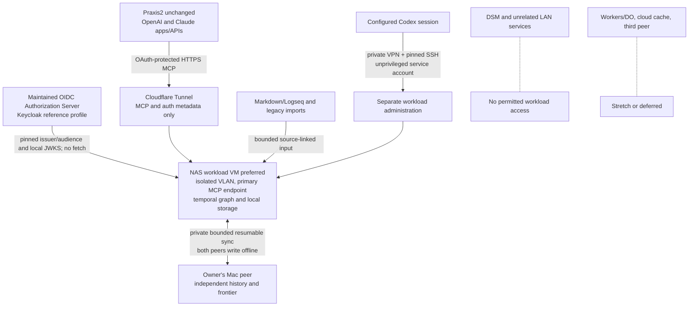

# RefactoredMemory Product Requirements

**Core contract clarification, 9 November 2026:** [A24](ADRS.md#a24-core-field-contract-and-focused-memory-crud) puts standardized fields and CRUD rules in RM itself. The [starter field catalog](FIELD-CATALOG-V1.md), [client contract](RM-CLIENT-CONTRACT.md), discovery and explicitly tagged assertion validation are implemented in this branch. The App is a focused explorer/editor over that core, with no internal conversation or model-management interface. L09–L12/FC01–FC08 still need deployment, universal-adoption and field-driven UI qualification; this partial implementation does not pass the full acceptance matrix.

**Client-led implementation, 9 November 2026:** The journal-backed workspace tools, pinned briefs, client task checkpoints and optional graph App are implemented in this branch. See [the workspace guide](CLIENT-LED-WORKSPACE.md) and [executed qualification](CLIENT-LED-VALIDATION.md). Historical requirements-only notes below describe their earlier documentation revision; named provider products still require separate live qualification.

**Requirements revision: 9 November 2026.** The client-led processing, cross-client integration and graph-review direction below supplements the personal-v1 baseline. Existing deployment/test notes retain their recorded evidence scope; this update does not refresh operational status or certify new functionality. See [A22/A23](ADRS.md#a22-client-led-processing-and-provider-independent-memory-roles).

**Status:** Approved personal-v1 scope; core and NAS-first local implementation available; deployment and client qualification incomplete. **Revised:** 7 November 2026. **Product owner:** the owner. **Confirmed release scope:** RefactoredMemory v1 is the owner's personal knowledge store. Multi-tenancy, personal versus corporate/multiple-corporate ownership, and product-level content encryption are later phases. This repository PRD is authoritative; the historical planning Page is reconciled through authorized access. The owner has explicitly said **“Proceed.”** The existing core implementation is available on `codex/personal-memory-v1`. The authorized NAS-first/OAuth local implementation now exists following the scope reconciliation; actual NAS access and deployment remain later. No additional proceed confirmation is required for this local work. The evidence summary below records implemented behavior and remaining acceptance gaps. Approval does not authorize live data ingestion or external deployment. Linear work remains paused.

**Confirmed MCP target and repository boundary:** The owner uses **Praxis2** and targets **OpenAI Pro 500 and Claude Max 5x applications and APIs**. These are the owner's reported client plans, not verified entitlement to every connector, API or OAuth flow. RefactoredMemory must provide standards-conformant MCP 2026-07-28 stdio and Streamable HTTP connections, with the latest published stable revision rechecked for future upgrades. No changes to either the Praxis or Praxis2 repository—including client code, provider endpoints or approval paths—are authorized or required by this task. Installed Praxis2 and provider application/API behavior remain unverified until each supported connection is exercised. Any hardcoded-provider or account capability limitation is an external interoperability evidence gap, not work to change the Praxis repositories. Each approved model client may read the whole personal store and automatically submit inferred captures within its own current grant; model clients never receive owner-kind authority.

## Current implementation and evidence

Operational hardening now includes validated atomic backup publication with snapshot-correct receipts, bounded query memory, absolute inbound/outbound network deadlines and cancellable synchronization. The current Linux suite passed 163 tests; Ubuntu CI passed all 163 and macOS ran 163 with two Linux-only memory-limit checks skipped. The [current evidence](ACCEPTANCE-RESULTS.md#current-operational-hardening-qualification) pins the runtime, container/operator checks and benchmark. Follow [NAS commissioning](NAS-COMMISSIONING.md) for explicit bootstrap and isolated recovery. These results do not qualify the actual NAS, owner Mac or hosted provider accounts.

The implementation is available on [codex/personal-memory-v1](https://github.com/ProvisioInsights/RefactoredMemory/tree/codex/personal-memory-v1/docs). It includes the temporal graph and CLI, two local offline-writable peers with direct synchronization, documented Markdown/Logseq and legacy-format import adapters, and verified synthetic restart/restore recovery. Linux synthetic checks have passed for the exercised scope, including the three day-one workflows. The already installed independent Python MCP SDK 1.29.0 passed against the real service over the separate 2025-11-25 stdio compatibility path. Modern 2026-07-28 protocol/schema checks are recorded separately; that legacy-client result does not prove a modern-client or actual Praxis2 integration. The official MCP specification permits custom authorization strategies. The original HTTP baseline used owner-preconfigured opaque bearer grants. The local NAS extension now implements OAuth protected-resource metadata and token validation, an explicit legacy HTTP profile alongside latest-stable MCP, separate MCP/sync TLS listeners in one Store process, bounded automatic sync with persistent backoff and disk-headroom controls, and deployment/maintenance artifacts. The Authorization Server remains a maintained external or self-hosted service, with an optional Keycloak/Postgres reference. The native Linux and Ubuntu CI suites passed, and the real Keycloak/Postgres Docker integration passed PKCE login, signed-token access, sourced OAuth write/read, bidirectional TLS sync, restart persistence, current-grant revocation and a selected cross-network denial check. The [acceptance report](ACCEPTANCE-RESULTS.md) and [raw container evidence](results/ops-docker-smoke.json) record the exact runtime, commands and limits. These are local results, not actual NAS/Mac, provider onboarding or general network-isolation certification.

See [acceptance results](ACCEPTANCE-RESULTS.md), [MCP conformance and client matrix](MCP-CONFORMANCE.md), [supported import formats and fidelity limits](IMPORT-FORMATS.md), [sync and recovery protocol](SYNC-PROTOCOL.md), and [run instructions](RUNBOOK.md). Full v1 release acceptance remains incomplete: the owner's actual Mac/NAS pair, installed Praxis2/OpenAI/Claude applications and APIs, and complete migration of original LivingAtlas archives remain unverified. Available Linux/Docker tests and macOS CI can qualify local artifacts; they do not establish actual NAS deployment or provider-account entitlement. All recorded data tests use synthetic fixtures; this evidence update does not authorize live-data ingestion, original-key use or external deployment.

## NAS-first local implementation and qualification

The local deployment implementation uses the NAS-hosted Linux peer as the primary MCP endpoint while retaining independent offline writes on the owner's Mac and NAS. The owner reports an RS822+ running current DSM; exact package support/resources and effective network rules are not yet verified. Prefer a dedicated workload Linux VM on its own VLAN, or a hardened container with its own VLAN and independently verified host/LAN restrictions. The NAS stays on its existing main LAN. Store the live SQLite database on local workload storage, never SMB/NFS.

Cloudflare Tunnel is the only selected Cloudflare component. Publish only MCP and RFC 9728 protected-resource metadata with appropriate 401/403 challenges. Run a distinct private TLS sync-only listener in the same Store process; keep administration separately private. Preserve latest-stable behavior, with 2025-11-25 HTTP compatibility available only as an explicit profile. Restrict app and tunnel egress to required named destinations, and deny unrelated LAN/DSM access through enforced network controls. The resource server performs no Authorization Server or JWKS network discovery/fetch. Harden containers with an unprivileged user, read-only root, minimum writable service data, dropped capabilities and resource limits; no Docker socket, host networking, privileged mode or broad NAS-share mounts. These controls are a design/test requirement, not a guarantee against host compromise.

The implemented OAuth protected-resource adapter uses a maintained Authorization Server: configured external OIDC is the default, with an optional Keycloak/Postgres reference profile whose real local Docker integration has passed and whose NAS sizing remains unverified. Pin a fixed HTTPS issuer, resource audience and local JWKS; reload local keys on each request and never fetch token-supplied or issuer/JWKS URLs. Accept RS256 access tokens only, require lifetime at most 300 seconds with at most 30 seconds clock leeway (5 seconds by default), and bind subject plus azp/client_id to an existing private agent-grant token file. Intersect memory:read, memory:write and memory:correct token scopes with that current active local grant on every call; reject owner/peer bindings and revoked grants. Approved Praxis2/OpenAI/Claude clients may read the whole personal store and automatically submit inferred captures under their own grants; they never acquire owner-kind or administration authority. Keep the existing bearer profile explicit for clients that use it. Actual app/API entitlement and onboarding evidence are separate from protocol tests.

Automatic synchronization must remain bounded and resumable: durable progress and persistent Retry-After/backoff state, configured batch/time/request budgets, an fcntl single-run lock, pause controls and a disk-headroom guard that stops before unsafe writes with a visible reason. Both peers remain writable offline; the scheduler does not change causal or correction semantics. Workers/Durable Objects, cloud caching and a third peer are stretch/deferred work.

Preferred maintenance access is a private VPN such as Tailscale plus a dedicated unprivileged SSH account on the workload VM, not a DSM administrator. Pin the SSH host key, restrict permissions to the service and inject secrets through secure environment/secret storage outside source control and logs. This supports authorized work during configured Codex sessions; it does not create an unattended Codex agent or imply continuous model execution.

The reconciled scope now has local implementation and test artifacts using available Linux/Docker-in-Docker capabilities and macOS CI. Native Linux, Ubuntu/macOS CI and the real Keycloak/Postgres Docker integration passed; exact validation is recorded in the acceptance/conformance reports. Hosted macOS CI passed; no NAS VPN is configured. M21–M25 distinguish implemented code and local evidence from actual environment qualification; they are not blanket passes from the earlier core tests. Actual NAS access, Mac/NAS execution, provider applications/APIs and live-data handling remain separate later qualification or authorization steps.

RefactoredMemory v1 is a **single-owner personal temporal knowledge store**: stable entities connected by sourced assertions and relationships whose world time and knowledge history remain distinct. It must integrate through the latest published stable MCP standard with Praxis2, the owner's OpenAI/Claude applications and APIs, and other compatible MCP clients. **The owner's Mac and a NAS-hosted Linux peer must both support offline writes and synchronization in v1.** Both belong to the same personal owner; this does not imply multi-tenancy. Day-one input includes explicit MCP capture, a bounded **Markdown/Logseq importer**, and **import/migration of data from previous LivingAtlas runs**. Inventory the available source layouts and prior store/run generations during research; those are evidence and compatibility tasks, not an open choice about v1 inclusion. Model-inferred additions may be accepted automatically within configured client/agent grants, without per-item human review; acceptance preserves provenance and uncertainty and does not mean human verification or established truth.

V1 prioritizes the owner's useful personal MCP capture, initial Markdown/Logseq and prior-LivingAtlas-run import, retrieval, correction, provenance and history workflows, with operational simplicity and open technology choices. A personal store can contain knowledge about organizations without implementing corporate tenants or corporate data ownership. Local, on-premises, SaaS and hybrid growth, multi-tenant/multi-corporate ownership, and encrypted product profiles remain later roadmap targets. Preserve extension paths without making their implementation or policy qualification a v1 dependency.

The [architecture decisions](ADRS.md) record accepted, selected and deferred choices. The [research ledger](RESEARCH.md) summarizes reviewed sources, the supplied M5 Max Atlas/SQLite selective-read result and qualification gaps. The full historical evaluation and its separate reference experiments remain in the authorized planning source; they are not reproduced in that summary. A synthetic-data plaintext development profile supports initial proofs; sensitive-data rollout and public exposure are separate decisions. RefactoredMemory uses the existing repository and selected cloud environment; Atlas/LivingAtlas identify historical sources and predecessor contracts. Development, tests and demonstrations use synthetic data only unless the owner explicitly approves otherwise. The personal-store goal is not approval to ingest real personal data.

# Client-led processing and review direction

**Accepted owner clarification, 9 November 2026.** Connected LLM applications and authorized external runners perform extraction, interpretation, organization and synthesis. RM provides reliable memory: deterministic validation, evidence, attribution, temporal queries, correction history, permissions and Mac/NAS synchronization. An embedded model, provider API key, autonomous intelligence service or background consolidation engine is not required. A22 and A23 record this direction; the requirements below describe intended behavior, not completed implementation or client qualification.

The end-user experience stays simple: ask a connected assistant to organize or explain memory, inspect the result, and correct it when needed. Users should not have to select a model for every operation or manage a processing pipeline. Existing client selection and permissions control where processing occurs. RM must not silently send data to a different provider, provision a paid processor, or treat a connected chat as an unattended worker.

| ID | Product requirement | Delivery boundary |
| --- | --- | --- |
| L01 | Connected clients do the LLM processing; RM validates, stores, retrieves, attributes and synchronizes their contributions. | Core design. Internal intelligence is optional future work, not a release prerequisite. |
| L02 | Support a non-exclusive target set: OpenAI ChatGPT and Codex; Anthropic Claude Chat, Cowork and Claude Code; Google Gemini; Grok; local-model hosts/runners; Praxis; and further compatible clients. | Qualify each product/account/transport separately. MCP tools and structured/text fallback remain useful without MCP Apps. Target status does not establish support, access, billing or deployment. |
| L03 | Preserve four memory roles: source records, structured temporal knowledge, derived memory and bounded working context. | Sources and the temporal graph are implemented foundations. Maintained summaries, freshness tracking and richer context assembly remain further work; roles do not imply four databases or trust grades. |
| L04 | Attribute each contribution and review to its initiator, authenticated connection, external processor when reported, supporting inputs, affected records, action and outcome. | Existing actor/provenance fields are the foundation. The consistent activity model and end-user explanation across all write paths require implementation and qualification under A23. |
| L05 | Keep automatic admission, uncertain interpretation and explicit owner verification distinct. | Retain Q6 automatic acceptance within grants and Q8 preferred authenticated owner corrections. Comments and review do not introduce mandatory per-item approval. A review applies only to the specified claim/revision. |
| L06 | Provide focused graph/list exploration and CRUD: search, select a record or relationship, inspect its evidence, create/edit/remove through current grants, and inspect history. | A24 narrows the everyday interface. Review flags belong on records and filters; conversation, task and model-management screens are outside the App. Existing annotation/job capabilities retain compatibility, not primary navigation. |
| L07 | Use an optional portable RM MCP App for capable hosts, with the same authoritative tools and permission checks as other clients. | Capability detection, sandboxing and host-mediated authorized calls are required. Graph selection must not automatically disclose the whole graph/source corpus to the model. No Praxis repository changes or public exposure follow from this document update. |
| L08 | Make client-led batches bounded, resumable, repeat-safe and inspectable; show incomplete work when no authorized processor is active. | Shared task/checkpoint conventions are planned integration work. No internal scheduler, broker or distributed worker fleet is required. A memory-access grant does not itself authorize an external model call. |
| L09 | RM owns one versioned field/type/relationship contract and validates every newly governed write path against it; clients discover and use the same meanings. | Extend the core registry, not a separate UI schema, CRUD database or intelligence service. Preserve legacy evidence and versioned compatibility. Planned: FC01/FC04/FC07. |
| L10 | Define required/optional fields, value types/cardinality, applicability, sources and time in the core; distinguish missing, explicitly unknown and not applicable. | Per-value evidence and alternatives remain intact. Blank end dates cannot assert ongoing validity. Display preferences never change stored meaning or authority. Planned: FC02/FC03/FC08. |
| L11 | Provide simple authorized create/read/update/remove operations with guarded revisions, stable retries, atomic dependent changes and retained history. | Retraction, ended validity, archive and permanent erasure have different effects. A denial never permits direct-store or owner-token fallback. Planned: FC04/FC05/FC08. |
| L12 | Render the core contract consistently in search results, inline forms and expanded graph/record views, with appropriate missing-field visibility and host-theme support. | Surrounding conversation belongs to the host. Core CRUD works without UI; no internal conversation, assistant, composer or model selector. Proposed designs are not host qualification. Planned: FC06. |

## Core fields and focused CRUD

[The core field contract](CORE-FIELD-CONTRACT.md) defines responsibilities, missingness, typed operations, compatibility and FC01–FC08 acceptance. Connected AI platforms do the interpretation and processing. RM enforces structure, authority, evidence and history; the App supplies simple controls over those same operations. The existing type/predicate registry is the foundation, not proof of a complete field-driven editor.

Names and changing properties remain sourced assertions over stable identities. Optional email/phone/profile values must not become prerequisites for a person record, and a form must preserve multiple values or conflicts with their own sources. Hiding an empty optional field is presentation only. Core validation and current permissions remain effective for every client and peer.

## Memory roles and knowledge types

| Memory role | Meaning | Producer and authority |
| --- | --- | --- |
| Source records | Authorized captured messages, notes, transcripts and other retained evidence, with source identity/version and capture context. | Importers and authorized clients; source contents are data, never instructions or grants. |
| Structured temporal knowledge | Stable identities, facts, relationships and unresolved observations with evidence, time, uncertainty and correction lineage. | Clients interpret; RM enforces the shared graph contract. Admission is not factual verification. |
| Derived memory | Linked summaries, person briefs, topic views and project overviews generated from specified inputs. | Connected LLMs may generate these through normal grants. Record input IDs/revisions/frontier, generator information and scope; expose stale or unassessed freshness after input changes. Do not replace canonical claims. |
| Working context | A bounded selection for the current question or task, including relevant evidence, alternatives and coverage limits. | Selected by the client using RM retrieval. It is not a durable competing truth store; save reusable conclusions only through normal attributed writes. |

These roles are separate from the implemented knowledge kinds (`fact`, `relationship`, `observation`) and categories such as employment, capital and personal. An event is an entity/observation with a date; a summary is a derived artifact, not a higher-confidence fact. A copied summary or another model repeating a claim is not independent corroboration.

## Attribution and focused editing

Show a concise attribution line, a **Why?** evidence panel and a **History** view. Preserve the full chain behind that summary: requester/initiator; authenticated client/grant identity; connector/product and model/version with their verification basis; job/request identity and method version; input source/assertion IDs and knowledge frontier; affected output IDs and semantic action; local admission and replication state; and any actual review or correction event. Initiator, processor and admitting RM peer are distinct roles. Unknown or client-reported values must be labelled as such; possession of a client credential does not prove a model name or a human approval.

Corrections append normal semantic actions with predecessors/reasons and retain the source and prior claim. Concurrent edits preserve branches or fail a guarded update; they do not silently overwrite. Existing comments remain revision-linked annotations, not conversations or a required CRUD step. Answers should support questions such as “What did this connector add?”, “Which model suggested this relationship?” and “What did I correct?” without exposing secrets or recording raw credentials in activity history.

For an illustrative fundraising workflow, RM must distinguish “mentioned”, “introduced”, “expressed conditional interest” and “invested”. Clicking an edge reveals its sources, dates, ambiguity and derivation; it does not promote a legacy label to a completed investment. This is a synthetic acceptance scenario, not a statement about any real person.

## Acceptance for this direction

L01–L08 supplement the preserved C01–C30/M01–M25 requirements. The following cases are planned qualification, not tests executed by this documentation change:

| Case | Required outcome |
| --- | --- |
| LM01 Client-led processing | With no model configured inside RM, an authorized client retrieves bounded synthetic evidence, submits a sourced inference and retrieves it with attribution; malformed/out-of-grant actions fail. |
| LM02 Portable clients | Two independently configured clients retrieve the same fixed-frontier knowledge and see a retained correction; tools work without UI. Mark every unexercised target product unverified. |
| LM03 Contributor attribution | Distinguish a requester, connector, reported processor, admitting peer and owner review. Reject attempts to self-assign owner authority; retain unknown model/version and trace input/output IDs and connector-specific changes. |
| LM04 Layers and freshness | A linked summary retains its input revisions/frontier. A subsequent correction makes an old summary visibly stale or of unassessed freshness; source search remains available and earlier history is unchanged. |
| LM05 Graph review | Inspect a bounded synthetic neighborhood and an edge's evidence, add a comment, correct a claim, then observe history and peer convergence. Test concurrent edits, unauthorized calls and a display-only host's honest limitation. |
| LM06 Interrupted processing | Interrupt a client batch, resume with a stable request/checkpoint identity, and recheck permissions and changed inputs before admission. No duplicate contribution, fabricated completion, new provider fallback or silent data transfer occurs. |

# Small useful core

V1 has four required responsibilities, which may share one small process on each personal peer:

1. **Temporal graph:** entities, immutable assertions, typed relationships, evidence and correction lineage, with separate world and knowledge time. Explicit MCP capture and the Markdown/Logseq and prior-LivingAtlas-run importer enter this same semantic boundary; import does not bypass provenance or the confirmed automatic-acceptance policy within configured client/agent grants.

2. **Local persistence and queries:** durable graph writes, temporal reads, bounded traversal, timeline/history and text search. Local indexes are derived from the graph history.

3. **Personal-device replication:** exchange graph operations and dependencies between two of the owner's admitted peers, preserve offline writes and concurrent changes, recover from interruption, and expose each answering peer's knowledge frontier. The NAS is the primary MCP endpoint, while both Mac and NAS remain independently writable offline. Automatic synchronization must be bounded, resumable and subject to pause, backoff and low-disk safeguards.

4. **MCP and inspection:** a required MCP server over the same authenticated graph API, targeting the independent clients in L02, with source, time, history, conflicts and currently enforced personal-owner/client grants inspectable. Q9 established MCP and CLI first; A23 adds the next graph/evidence/review interface direction while preserving useful non-UI tools.

Each personal peer should be packageable as one process with a local temporal graph and derived views. The selected initial engineering stack is Python 3.12+ using the standard library and SQLite in WAL mode with synchronous=FULL, an immutable atomic operation journal, explicit dependency-based direct sync and local grants separate from replicated history (ADR A17). This is an implementation selection for operational simplicity and a testable correctness path, not a benchmark winner or a claim of completed qualification. Q1/Q2 confirm two personal offline-writable peers: the owner's Mac and a NAS-hosted Linux peer. The reported NAS is an RS822+ on current DSM. Prefer a dedicated workload Linux VM with its own VLAN; a hardened container on its own VLAN is the fallback subject to actual package/resource verification. Keep the NAS's main-LAN arrangement unchanged. Build local deployment artifacts now; actual NAS access, provisioning and verification happen later. A separate model runtime, graph server, broker, tenant platform or corporate policy engine is not required for v1.

The first useful outcome is: from Praxis2 or another supported MCP client, save a sourced personal fact or relationship, retrieve it with evidence and independent world/knowledge time, correct it while the other personal peer is disconnected, reconnect, and obtain converged temporal history without rewriting what either peer previously knew. Concurrent offline corrections remain visible, and restart/restore preserves acknowledged work. Synthetic Markdown/Logseq and historical LivingAtlas-format fixtures must produce inspectable source-linked records, preserve original time/correction lineage and identity or explicit mappings, tolerate repeat imports without duplication, and handle source updates through documented version/correction semantics. The confirmed day-one tasks are to explain project decisions and why they were made, retrieve a person's relationships with supporting evidence, and show what changed since last month.

# Temporal graph semantics

| Element | Minimum meaning |
| --- | --- |
| Entity | A stable opaque identity for a person, organization, project or other supported type. Names, roles and changing attributes are sourced assertions, rather than a mutable bag of facts inside the entity. Authentication identities are separate. |
| Fact assertion | One typed statement about an entity, with its own identity, predicate, value, evidence, provenance, world-time expression and knowledge lineage. |
| Relationship assertion | A first-class assertion with a subject, registered predicate and target entity. Its valid interval, evidence and lineage determine whether an edge appears in a temporal graph view. |
| Observation | A bounded sourced statement whose meaning cannot yet be safely structured. It remains explicitly unresolved; it does not invent an entity, date or relationship. |
| Evidence | An immutable bounded source reference or captured excerpt/snapshot, with source identity, capture metadata and links that support, contradict or contextualize an assertion. |
| Lineage | New assertion records that correct, retract, invalidate or reinstate earlier assertions. Prior meanings remain readable through knowledge-history queries. |

The initial predicate registry needs only the types and cardinality rules used by the first fixtures. Validate entity references, typed values and relationship endpoints. Preserve unsupported material as a labelled observation or opaque import record; an unknown predicate or action must not silently become an affirmed edge. A universal ontology and automatic identity merging can follow.

**World time** describes when the claim holds in the world. State relationships use half-open intervals. Precision, approximation and unknown time remain explicit; unknown is never a sortable sentinel date. The existing contract's absent end means ongoing, which is different from an explicitly unknown end. Untimed material may be stored, but a date-filtered answer must report it as temporally unresolved rather than asserting a match. Full recurrence/calendar interpretation is deferred.

**Knowledge time** describes when a particular RefactoredMemory view acquired a claim or correction. Preserve origin commit metadata separately from each replica's receipt and causal-application history. A local knowledge position provides an unambiguous order even when wall clocks skew. A historical mesh query names a replica and knowledge position, or an explicit causally closed frontier. A timestamp form must resolve within that named replica's retained history; an unqualified global known-at timestamp is not defined.

These axes are part of the core even when a world date is unknown. A query may independently select valid-at world time and known-at knowledge state. Every query returns its namespace, answering replica, applied frontier, temporal match quality, unresolved branches and coverage limits. A missing claim on a disconnected peer is not proof that it is false.

**Correction actions have distinct meanings.** Correct replaces an erroneous recording with a new assertion. Retract says the earlier belief was mistaken; it does not invent a world event ending the relationship. Invalidate says a relationship held and then ended, retaining its earlier valid interval. Reinstate affirms previously retracted knowledge again. Each action names its predecessors and retains its source and reason. Ordinary administrative tombstones are separate from these semantic actions.

Two independently sourced claims can disagree without being revisions of one assertion. Preserve both and show alternatives; a predicate's declared exclusivity can mark a dispute. Conversely, concurrent corrections of the same lineage are replication branches. Neither case permits a clock-based winner, an invented blended fact or duplicated corroboration from copying a claim between peers.

## A concrete temporal example

All names and facts here are synthetic. On 10 January, peer A records that Rae works for Northstar, valid from 1 January with an ongoing end. On 5 February, it learns that the relationship ended on 1 February and appends an invalidation. On 10 February, better evidence corrects the end to 28 January.

| World question | Knowledge view on A | Answer |
| --- | --- | --- |
| Did the relationship hold on 15 January? | After the 5 February invalidation | Yes, within the retained valid interval. |
| Did it hold on 31 January? | After 5 February, before the correction | Yes, under the end date then known. |
| Did it hold on 31 January? | After the 10 February correction | No, under the corrected interval. The earlier belief is still readable. |
| What did peer B know before it received that correction? | B's own earlier knowledge position | B's prior view, labelled with its frontier. B must not backdate local knowledge to A's commit. |

If the original employment claim was instead a mistaken extraction, a retraction removes it from affirmed graph views after that knowledge action, including queries about earlier world dates. The graph can still show that it was believed before the retraction. Graph traversal, assertion lookup and text search must apply the same lineage and temporal rules.

These semantics extend the existing [canonical knowledge records](https://github.com/ProvisioInsights/LivingAtlas/blob/e36ebe821eafb3fc00093b6afcc2c4c6e0c4c30d/docs/architecture/adr-0004-canonical-knowledge-records.md) and [assertion lineage](https://github.com/ProvisioInsights/LivingAtlas/blob/e36ebe821eafb3fc00093b6afcc2c4c6e0c4c30d/docs/architecture/adr-0005-assertion-lineage-and-evidence.md). The new replica-scoped knowledge contract is proposed; it must be versioned rather than silently changing the published single-writer API.

# Decisions and defaults

The owner has confirmed personal knowledge storage, two personal offline-writable peers on the owner's Mac and a NAS-hosted Linux peer, and MCP plus Markdown/Logseq and previous-LivingAtlas-run import as v1. Temporal semantics, operational simplicity, source-linked memory, open technology choice and mandatory latest-stable MCP integration remain core. Multi-tenancy, corporate versus personal ownership and product content encryption are later work. Basic personal-owner/client authority and transport protections remain in v1. Q6 confirms automatic acceptance of inferred additions within configured client/agent grants; no per-item human review is required. Q7 confirms proactive useful-knowledge capture within configured grants; Q8 prefers explicit owner corrections while retaining conflicts/evidence/history; Q9 established MCP+CLI first; A23 adds the next graph-review direction; Q10 accepts the three day-one tasks. The owner has explicitly authorized implementation by saying “Proceed,” following the completed scope reconciliation; implementation evidence and remaining qualification are recorded below. Source locations, layouts and historical store generations are research evidence/compatibility tasks.

| ID | Material question | Status or confirmed direction | Consequence |
| --- | --- | --- | --- |
| Q1 | One primary personal store, or two personal devices that can independently write offline and synchronize? | Confirmed: two personal peers with offline writes and synchronization are required in v1. | Include causal delivery, offline/concurrent corrections, reconnect, convergence and recovery. Both peers belong to the same personal owner; corporate tenants are not implied. |
| Q2 | Which initial runtime(s) and connection arrangement should v1 qualify? | Confirmed: the owner's Mac plus an RS822+-hosted Linux peer, with the NAS as primary MCP endpoint and both peers writable offline. | Prefer a workload VM on its own VLAN; hardened-container fallback requires equivalent tested restrictions. Keep the NAS on its existing main LAN. Build locally first; actual NAS access/provisioning and live-data use are later. |
| Q3 | When organizations are supported later, does each retain its own data after departure while the person retains personal data? | Ownership principle previously confirmed; corporate implementation deferred beyond v1. | Corporate tenancy, memberships, offboarding, mixed-source classification and recovery are later requirements. |
| Q4 | Who can recover encrypted personal data and what happens if all recovery factors are lost? | Deferred with product content encryption. | A future protection profile must resolve custody/recovery and its trust assumptions; it does not block personal-store v1. |
| Q5 | Which initial inputs must v1 support? | Confirmed: MCP capture, Markdown/Logseq, and data from previous LivingAtlas runs. | Inventory available source layouts and historical run/store generations; preserve identity/mappings, sources, provenance, world/knowledge time and correction lineage. Require idempotency, update semantics, visible accounting and safe source boundaries. Real-data ingestion and use of original decryption keys remain separately authorized. |
| Q6 | Do inferred additions wait for review or enter under a configured automatic-write grant? | Confirmed: automatic acceptance within configured client/agent grants, without per-item human review. | Preserve source/evidence, actor/model/derivation attribution, uncertainty, correction history and conflicts. Acceptance is not human verification or established truth; source text cannot grant authority. |
| Q7 | Should clients proactively capture useful knowledge or write only on explicit requests? | Confirmed: proactive capture of useful knowledge within configured client/agent grants. | Preserve evidence/attribution and bounded source/write scope; proactive capture does not grant new source access or authorize live personal-data use. |
| Q8 | When claims conflict, should explicit human corrections receive preference or should there be no preferred claim? | Confirmed: prefer explicit owner corrections. | Apply preference at the requested temporal/knowledge view; retain conflicting assertions, evidence, uncertainty and correction history. A model/source cannot self-assign owner-correction authority; equally applicable unresolved owner corrections remain visible. |
| Q9 | Is v1 inspection MCP/CLI only or should it include a small browser inspection UI? | Historical baseline: MCP and CLI first. The 9 November A23 direction adds graph/evidence/review through an optional MCP App. | Preserve non-UI inspection and separately qualify the new comments, corrections, attribution and host capabilities; do not retroactively mark old tests as UI acceptance. |
| Q10 | Which concrete day-one questions/tasks must v1 make useful? | Confirmed: project decisions and why; a person's relationships and evidence; changes since last month. | C25/M20 require synthetic end-to-end fixtures with sources, time, conflict/coverage limits and correct history. |
| Q11 | Which NAS deployment and exposure profile is required? | Confirmed: Mac plus NAS-hosted Linux peer; NAS primary MCP endpoint. RS822+ and current DSM are owner-reported. | Prefer a dedicated workload VM on its own VLAN; hardened-container fallback. Keep NAS main LAN unchanged. Cloudflare Tunnel exposes only MCP/required auth metadata; private sync/admin remain separate. |
| Q12 | Which clients and authorization profile should the NAS serve? | Confirmed: unchanged Praxis2 and the owner's OpenAI Pro 500/Claude Max 5x apps and APIs; whole-personal-store reads and automatic inferred capture within separate grants. | Add a maintained external/self-hosted OIDC Authorization Server and OAuth resource adapter, with an optional Keycloak/Postgres reference profile. Pin HTTPS issuer/audience/local JWKS and strict subject/client binding; never give a model owner-kind authority. Actual plan entitlements and client flows require verification. |
| Q13 | Should peer synchronization run automatically? | Confirmed: automatic, bounded and resumable. | Preserve offline writes and causal convergence; enforce Retry-After/backoff, explicit operator/budget pause and low-disk stop. No cloud cache or third peer is required. |
| Q14 | How should Codex reach the workload for authorized maintenance? | Confirmed preferred path: private VPN such as Tailscale plus a dedicated unprivileged SSH account on the workload VM. | Pin host keys; scope access to this service, keep secrets in secure environment/secret storage, and never use DSM administrator access. Availability during configured Codex sessions is not an unattended agent service. |
| Q15 | When should NAS deployment work begin? | Confirmed: reconcile docs, then build and test locally; NAS access later. | Use available Linux/Docker tests and macOS CI. Actual NAS/Mac and provider app/API runs remain unverified until performed; do not turn local evidence into a deployment claim. |

Q1/Q2/Q5/Q6/Q7/Q8/Q9/Q10 are confirmed for personal v1: Mac plus NAS-hosted Linux offline-writable peers, required MCP, Markdown/Logseq and prior-run migration, automatic inferred acceptance, proactive capture within grants, explicit-owner correction preference, MCP+CLI inspection and all three day-one tasks. Q3 remains a confirmed later ownership principle; Q4 and corporate/protected profiles are later. ADR A17 records the initial Python/SQLite implementation; A18–A21 specify the approved NAS-first deployment, OAuth resource adapter, automatic sync and scoped agent-access expansion. The owner has explicitly said “Proceed”; the implementation now exists, and qualification continues without requesting the same approval again. Source availability, actual client access and engineering conformance must be assessed against the recorded evidence; implementation alone is not full release acceptance.

V1 does not require corporate tenants, employer lifecycle, product content encryption/key custody, continuous automatic ingestion, background AI, advanced identity federation, recurrence solvers, vector retrieval or maintained-decision automation. Q5 requires bounded Markdown/Logseq import and migration of prior LivingAtlas-run data; inventory actual source layouts/store generations and record compatibility gaps. Q6 permits inferred additions to be accepted automatically within configured client/agent grants, with no per-item human review. Q7 confirms proactive useful-knowledge capture within configured grants; this does not require a separate continuous-ingestion or model service. Temporal graph reads, evidence, correction lineage, basic time precision, personal access controls and working MCP integration remain core. The explicit implementation approval has been received; the core and approved NAS-first expansion have local implementation artifacts, with qualification tracked against actual evidence. Actual NAS access remains later.

The earlier offline-interpretation question is superseded for the core: interpretation is an optional client. No hosted AI or paid processing follows from synchronization.

# Deployment topologies

| Topology | What it does | Offline behavior | Release position |
| --- | --- | --- | --- |
| One personal peer | Stores/queries the owner's graph and serves authorized MCP clients. | Local reads/writes continue. | The building block on each of v1's two peers; not the complete v1 delivery by itself. |
| Two personal writable peers | The owner's Mac and a NAS-hosted Linux peer each store history and commit local changes. | Local reads/writes continue; views may differ until synchronization. | Confirmed v1 under Q1/Q2; NAS is the primary MCP endpoint, not an exclusive writer. |
| Optional relay | Receives/forwards retained changes so personal peers need not be simultaneously reachable. | Delivery waits for an authorized path. | Later unless separately agreed. |
| Transitive personal mesh | Admitted peers/relays forward operations and converge. | Eventual convergence under the declared delivery/admission model. | Separately qualified later; direct two-peer sync does not establish it. |
| Multi-tenant/corporate shared service | Distinct personal and organization ownership domains, memberships and policies. | Depends on its later architecture. | Deferred beyond v1. |

The two personal peers need durable storage and a qualified implementation runtime on the owner's Mac and a NAS-hosted Linux peer. The NAS model/current DSM are owner-reported; available packages, resources, VLAN enforcement and filesystem behavior remain device checks. Build deployment artifacts and tests locally now. Actual NAS access/provisioning is later and does not follow automatically from local test success. Windows, browser-hosted storage, mobile full peers and hosted multi-tenant services are not v1 claims.

Use Cloudflare Tunnel only as transport to the NAS-hosted MCP gateway; it does not replace OAuth or current grants. Cloudflare Workers/Durable Objects ports, a cloud cache and a third peer remain stretch/deferred scope, with no v1 storage or availability claim.

Configure a small set of endpoints explicitly. The public tunnel may reach only MCP and required authentication metadata. Sync and administration use separately restricted private routes. General peer discovery, global membership consensus and unrestricted federation are outside the core.

# V1 personal-device sync and conflict contract

Two personal offline-writable peers are required in v1 under confirmed Q1. Replicate **temporal graph operations**, rather than database files or only the current entity/edge view. Each full peer stores its own graph history. A shared network folder or ordinary file-sync service is not the synchronization protocol. Relay/transitive mesh is separately scoped later.

Every graph operation has a stable opaque ID, namespace, schema version, origin peer/incarnation/sequence, causal dependencies and a versioned payload representation. Assertion identity and supersedes links identify semantic lineage; transport parent/dependency links provide causal delivery. Both must be preserved. Authoritative origin attribution comes from authenticated admission, not a caller-supplied name.

New assertions and relationships are immutable semantic events. Corrections, retractions, invalidations and reinstatements append new assertions naming predecessors. Local projections of active heads or supersession are rebuildable; a replicated single mutable superseded-at field cannot decide between concurrent branches. Wall-clock timestamps describe origin/local events and never choose truth or a winning branch.

Distinct additions coexist; duplicate delivery of one operation has no second effect. Claims with different assertion identities retain their own provenance, even when their content resembles another claim. A semantic dispute between sources is distinct from concurrent descendants of one lineage. A resolution appends a sourced action referencing all predecessor heads considered by that authorized resolution, can retain uncertainty, and can be reopened by a newly discovered branch. Search and traversal retain unresolved alternatives and expose the confirmed preference for an explicit, authorized owner correction in the applicable temporal view. Preference does not delete contrary evidence/history, authorize a model to claim owner status, or resolve equally applicable competing owner corrections silently.

Administrative deletes are tombstones, separate from belief retraction or world invalidation. A concurrent delete/edit is visible, and a stale peer cannot silently resurrect deleted availability. No physical purge or source-history erasure follows from correction. Retain required deletion/causal metadata; retired or too-stale peers may need a verified snapshot reseed.

Sync exchanges bounded summaries/checkpoints, missing operations and their required entities, assertion predecessors and evidence. Validate identity, namespace, schema and causal dependencies before exposing an operation as graph state. Durably received progress is separate from causally applied progress. Checkpoints cannot skip sequence gaps; missing dependencies remain visible. Only a complete admitted graph-operation group becomes query-visible.

Repeated delivery, response loss and routing through another peer are idempotent. Reject contradictory logical contents under the same operation ID. A restored or cloned directory must use controlled rejoin or a fresh peer identity/incarnation, rather than reusing an active origin sequence stream.

Convergence means peers with the same admitted operations, semantic contract and chosen knowledge frontier derive the same assertions, graph edges, lineage branches, tombstones and temporal answers. Receipt histories can differ, so each peer's past local knowledge remains distinct. Disconnection does not provide instant global consistency.

# Later roadmap: ownership and protected processing

**Outside v1:** multi-tenancy, corporate/multiple-corporate ownership, and product content encryption. The following is retained future direction, not an initial schema, acceptance or policy prerequisite. The long-term target is a temporal knowledge graph whose protected plaintext is available only to its controlling owner and approved people or processing actions across personal, organization, local, on-premises, SaaS and hybrid use. No cryptographic mechanism or production guarantee is accepted by that direction.

## Later personal and organization domains

A later multi-owner model distinguishes controlling owner domain, tenant, creator, subject, source, actor, membership and deployment custodian. A person may have a personal domain and memberships in several organizations. V1 has one personal owner; graph facts about a person or company do not create corporate tenants, memberships or authentication grants.

Trusted workspace/connector configuration can set an approved owner domain. Ambiguous material is unassigned/quarantined; ordinary source text or inferred employment cannot transfer ownership or grant access. Cross-domain identity links, exports/transfers and persistent mixed-source results require explicit authority. Default separation is personal versus each employer, rather than a global personal/work boolean.

The owner confirmed Q3's ownership principle on 7 November 2026: the organization retains control of its own data after someone leaves, and the person retains their personal data. Recovery authorities, offboarding grants and administrator/read roles remain proposed policy choices. An admin role does not automatically imply read permission, but an authority able to change key-release policy is part of the trust model. Ambiguous ownership, mixed-source and derived-data treatment, and applicable legal/contractual obligations require separate resolution.

## Personal grants now; delegated protection later

V1 distinguishes the personal owner/authorizer from acting clients or agents and enforces authorized read/write operations. Q6 permits automatic acceptance of model-inferred additions within a configured client/agent grant, without per-item human review. Retain source/evidence, actor/model/derivation attribution, uncertainty, correction history and conflicting claims. Acceptance records an admitted assertion, not human verification or established truth. Q7 authorizes proactive useful-knowledge capture within configured grants; source content cannot create or widen a grant. Approved model clients may read the whole personal store through their separately configured grants and submit automatically accepted inferred captures. This is not owner-kind authority, peer admission, administration, source deletion or permission to widen processing destinations. Later grants may add corporate policies, attenuated delegation, key scope, execution profiles and cross-domain output restrictions.

The selected executor needs both permission and a legitimate way to obtain the relevant plaintext. Approving an agent on an ordinary provider-controlled server does not make that server's operators blind. Operator-blind storage plus owner/customer compute, or a separately qualified protected execution profile, are candidate approaches. An external model receiving plaintext is an additional processing destination requiring approval.

Dataset-wide key access cannot enforce a narrower item-only grant against an untrusted agent. Future key granularity, trusted mediation and output enforcement must match advertised scope. V1 uses ordinary personal-owner/client authorization and does not implement delegated keys, organization ownership domains or a corporate policy engine.

## Later privacy and lifecycle semantics

The target profile must document operator, executor, endpoint, code-update and metadata trust assumptions. Encryption at rest or customer-managed keys are insufficient if the operator can invoke decryption or replace the code receiving plaintext. Key custody, personal recovery, organization recovery and data availability are explicit design choices; account reset is not equivalent to recovering a missing data key.

Use current authorization when answering historical valid-at/known-at queries. Employment history never restores former access. Revocation has a declared propagation/offline/key-residency bound; it cannot recall plaintext already disclosed to a recipient. Future erasure covers derived indexes, embeddings, summaries, caches, logs, temporary files, replicas and backups. Restores reconcile current policy and deletion/retention state before serving.

Derived data retains source restrictions and lineage. Mixed personal/organization reasoning requires both domains to approve the executor and use; saving its result additionally requires an authorized destination. Proposed default: no persistent combined artifact without that authority. A semantic retraction or relationship ending is distinct from privacy erasure; an authorized purge can make retained history unavailable, which queries must report.

## Now and later

**Now:** personal-owner/client authority, current access checks on historical reads, provenance, safe credentials and logs, durable local recovery, and appropriate transport protections. **Later:** C22/M17 corporate ownership/isolation, E07–E11 enterprise protection and lifecycle features, and P01–P06 encrypted/protected-profile qualification. C23/M18 retain only their ordinary personal-access requirements in v1. Product-level content encryption and corporate key recovery are not v1 gates. All development/test fixtures remain synthetic unless explicitly approved otherwise.

Before a later encrypted or corporate profile is advertised, choose its custody/recovery, execution/leakage and ownership policies and qualify the applicable future gates. Tenant count, cross-domain fan-out, protected traversal and cryptographic revocation measurements belong there. V1 still qualifies the basic personal access, data handling and transport protections it actually claims.

## Future protection qualification gates

These are proposed gates before advertising the relevant protected-data profile; none has been run or passed by this documentation work.

| Gate | Required evidence |
| --- | --- |
| P01 Operator and key boundary | Under the declared threat model, storage/ordinary operator roles cannot obtain protected payloads or silently replace the approved key-release/executor path. Include client/update, metadata, index, log, temporary and backup surfaces. |
| P02 Delegated processing | Lookup/cleanup grants enforce resources, actions, audience/profile, expiry, egress and onward-delegation limits. Negative tests deny export, destructive cleanup, transfer and external model use when unapproved. |
| P03 Owner lifecycle | Personal/two-employer fixtures enforce membership, organization recovery/offboarding policy and explicit transfers without personal-domain access. Current authority also governs historical reads and cross-domain joins. |
| P04 Recovery and revocation | Exercise the selected personal/org recovery roles, lost device/factors and compromised keys. Measure grant/key-cache expiry, offline revocation bounds and controlled rejoin; identify prior disclosures that cannot be recalled. |
| P05 Derivation erasure and restore | Invalidate/purge affected indexes, embeddings, summaries, caches and permitted backup/key copies; enforce holds/retention and current deletion policy after restore. Report unavailable history and unrecallable exports honestly. |
| P06 Privacy and scale cost | Measure end-to-end protected query/index/model/output work, key/policy overhead, tenant/domain fan-out, history growth, revocation/erasure backlog and recovery under the actual selected hardware/trust profile. Plaintext read timings cannot substitute. |

# V1 personal identity and trust boundaries

V1 has one personal owner and explicitly authorized human/client/agent principals. Distinguish the owner, acting principal, graph entity/subject, creator and source without implementing corporate tenants or employer memberships. A graph statement about employment or an organization cannot change authentication or authority. Retain stable IDs and versioned contracts as extension paths; do not prebuild the later corporate ownership model.

Ordinary knowledge writes cannot grant rights, enroll peers or change access policy. Apply current personal-owner/client grants to historical as well as current queries and to any enabled export or write destination. Filter unauthorized data before retrieval output, counts or derived persistence. Each personal peer has explicit admission and scope; cross-corporate isolation belongs to the later multi-tenant phase.

A full plaintext replica can read its bytes. API filters alone do not make it blind or enforce item-only access after it receives a dataset-wide key. Future scope/key granularity or trusted mediation must match the advertised grant. A provider-controlled plaintext executor is part of the trust boundary even when it runs an approved agent.

Authenticate the two personal endpoints and operation origins. A relay login is not proof of the original writer if relaying is added later. Use an established qualified mechanism for the agreed direct two-peer exchange. Future blind relays and protected executors are deferred with the encrypted profile.

V1 enforces revoked local client grants and avoids restoring obsolete access through an old snapshot. Document policy propagation limitations across the two offline personal peers. Cryptographic revocation, organization authority, corporate offboarding and key recovery remain later work; no instantaneous erasure of previously disclosed plaintext is promised.

# V1 access protections and deferred content encryption

Product-level content encryption, delegated keys, custody/recovery and operator-blind execution are deferred beyond v1. The later goal remains protected payloads available only to the controlling owner or approved processing contexts under a declared threat model. This deferral does not remove basic authentication, client/agent grants, local filesystem/access controls, safe credentials, or transport security.

V1 development/tests use a named **synthetic plaintext development** profile. This is a test profile for a personal knowledge-store product, not a claim of encrypted storage or operator blindness. Any actual personal-data import/use needs separate owner approval of the real storage/processing environment; the present update neither imports data nor opens a public endpoint. Later encryption cannot erase earlier plaintext copies.

Retain authenticated clients, bounded requests, redacted logs and protected cross-host transport such as HTTPS for remote MCP. Use local process/filesystem controls for stdio. Authenticate the two admitted personal peers. Preserve logical graph identity, provenance and versioned interfaces so a later encryption migration can preserve meaning; do not require key-policy envelopes, multiple-owner schemas or confidential-computing machinery in v1.

Candidate protected profiles include encrypted storage with owner/customer-side processing, organization-controlled execution, and separately qualified protected remote execution. Ordinary hosted plaintext processing is a different trust profile, not equivalent privacy. A browser/client update channel, external model endpoint, debug log, plaintext index and recovery path all belong in the chosen threat model.

Later protected deployments must choose owner-specific custody/recovery, trusted executors and permitted metadata and qualify the relevant P01–P06 gates. These gates do not block personal-store v1. Real personal-data use still needs explicit approval of its actual plaintext/storage/processing limits, and external deployment is a separate action. No encrypted production profile is accepted by this document.

# Core requirements

C01–C30 retain stable requirement IDs but distinguish required personal graph/sync/MCP/import behavior and later corporate scope. M01–M25 use the same scope classification. C22/M17 and P01–P06 are deferred; C23/M18 cover basic personal authority now. V1 must include two personal offline-writable peers and MCP interoperability under C24/M19 and initial import under C14/M11. C25/M20 add the three confirmed day-one tasks. C26–C30/M21–M25 track the implemented local deployment/OAuth/scheduler artifacts, delivered access runbook and remaining NAS/client qualification; code existence does not pass the entire acceptance set. The implementation evidence is recorded in the acceptance and conformance reports linked above. Passing Linux synthetic checks do not establish actual Mac/NAS/provider-client or original-archive qualification.

| ID | Requirement | Release scope and evidence |
| --- | --- | --- |
| C01 | Stable entity identities and schema-versioned facts, relationships, bounded unresolved observations and evidence; validate predicate/value/endpoint types. | V1: M01, M13. |
| C02 | Commit semantic operations and sync eligibility durably before acknowledgment; recover without losing acknowledged work or exposing partial groups. | V1: M01, M06. |
| C03 | Both admitted personal peers read/write their authorized personal graph while disconnected, with local knowledge frontier and staleness visible. | V1, Q1 confirmed: M03. |
| C04 | Exchange bounded missing graph operations and required entities/evidence/predecessors with durable progress, duplicate detection, causal dependencies and restart-safe identity/epochs. | V1: M03, M05, M06. |
| C05 | Preserve concurrent lineage heads in reads/search/traversal; resolve by sourced action naming the predecessor heads considered; no wall-clock truth winner. | V1: M04, M15. |
| C06 | Keep administrative tombstone/restore separate from retract/invalidate; expose delete/edit conflicts and prevent stale-peer resurrection. | V1: M07, M14. |
| C07 | Entity/assertion reads, valid-at and replica-scoped known-at, bounded temporal traversal, timeline/history, evidence lookup and text search. | V1: M01, M13, M14. |
| C08 | Authenticated graph/MCP access and inspectable source, derivation/review attribution, time, history, sync, conflicts and effective personal client grants; usable empty/error/offline responses. | V1: M02, M12, M19. Q9 confirms MCP+CLI only; browser UI is outside v1. |
| C09 | Protected cross-host transport, authenticated consumers/peers and origin admission, personal-scope rights and safe credentials. | V1: M02, M09. |
| C10 | Label the actual storage/processing profile. Synthetic development makes no encrypted-at-rest or operator-blind claim; real-data use needs separate approval. | V1: M02, M12. Product content encryption is later. |
| C11 | Version logical contracts and payload representations so later encoding/encryption migrations can preserve identity, semantics and provenance. | V1 portability: M10, M16. No key-policy engine required. |
| C12 | Replicate only the personal graph scope each admitted peer may hold; graph identity/writes cannot enroll peers or grant authority. | V1: M02, M09. Corporate tenants are later. |
| C13 | Export/restore consistent history, evidence, conflicts, tombstones and progress; reconcile current personal grants/deletion state; use fresh identity or controlled rejoin. | V1: M10, M16, personal subset of M18. |
| C14 | Import Markdown/Logseq and data from discovered prior LivingAtlas run/store generations through the graph contract. Inventory sources read-only; preserve original IDs or explicit mappings, provenance, world/knowledge time, correction lineage and unknown fidelity. Require idempotent repeat imports, documented update/correction behavior, source-level counts/accounting, visible errors/unsupported records, approved source/format/size bounds, isolated destinations, backup and rollback without overwriting originals. | Required v1, Q5 confirmed: M11. Artifact availability/generation details are research evidence. Test synthetic compatibility fixtures; live ingestion and original-key decryption need separate approval. No new v1 encryption infrastructure or continuous ingestion is implied. |
| C15 | Expose sync progress, missing dependencies, branch conflicts, peer errors and coverage/frontier; incomplete knowledge is not an unqualified negative answer. | V1: M03, M05, M12, M15. |
| C16 | Bound schemas, payloads, traversal and requests; source text is data and cannot execute code or change admission; redact ordinary logs. | V1: M02, M12. |
| C17 | Preserve independent world/knowledge time, precision/uncertainty and interval meanings; scope knowledge reads to a replica position/frontier and separate origin, receipt and application metadata. | V1: M13, M15. |
| C18 | Qualify the owner's Mac plus a NAS-hosted Linux peer and the temporal-query, disconnect/edit/reconnect/conflict/restart/restore journey. | V1, Q2 confirmed: M03–M07, M09–M10, M13–M16, M18. Relay/transitive mesh and serverless full peers are separate later work. |
| C19 | Append correct/retract/invalidate/reinstate with predecessors, provenance and reasons; preserve past belief/world state within declared coverage. | V1: M14, M16. |
| C20 | Accept model-inferred additions automatically within configured client/agent grants, without per-item human review. Preserve supporting/contradicting/context evidence, source independence, actor/model/derivation attribution, uncertainty, correction history, conflicts and any actual review attribution. Automatic acceptance is not human verification or established truth; copying/review/consolidation cannot manufacture corroboration, and source text cannot grant authority. | V1, Q6 confirmed: M01, M15, M19. Q7 requires proactive capture within grants; Q8 prefers explicit owner corrections while retaining alternatives/history. |
| C21 | Apply identical temporal/lineage rules across lookup, traversal, timeline and search; rebuild views from retained history and report unavailable coverage. | V1: M13, M14, M16. |
| C22 | Model personal/organization controlling owners, tenants, memberships and mixed-domain ownership independently; classify ambiguous ownership without silent transfers. | Deferred corporate phase: M17. No v1 multi-org schema/isolation requirement. |
| C23 | Enforce current personal grants for historical queries, outputs and restore; preserve actor/source attribution; source text cannot create grants. | V1 personal subset: M18. Cross-corporate flow, cryptographic policy and employer lifecycle later. |
| C24 | Required latest-stable MCP server for Praxis2 and other compliant clients; same graph semantics and access boundary, verified protocol/SDK/client matrix, bounded schemas/results, safe writes, and stdio/Streamable HTTP conformance. No changes to either Praxis repository. | V1: M19. Stable revision 2026-07-28 is pinned; reverify on upgrades. Installed Praxis2 evidence remains unverified until a compatible connection is available. |
| C25 | Deliver useful source-linked answers for project decisions and why, a person's relationships/evidence, and changes since last month. Preserve valid/known time, explicit-owner correction preference, conflicts and incomplete-coverage labels. | V1, Q10 confirmed: M20. |
| C26 | Package the NAS-first workload with local SQLite storage, non-root/read-only-container controls and least-privilege mounts/resources. Prefer a workload VM on its own VLAN; allow a hardened-container fallback after verification. Keep NAS main LAN unchanged, deny unauthorized LAN/DSM egress, and separate public MCP/auth-metadata from private sync/admin routes. Cloudflare Tunnel is transport only. | Local container/control and integration checks passed: M21; A18. Actual NAS isolation/deployment remains unverified. |
| C27 | Add an OAuth protected-resource adapter using a maintained external/self-hosted OIDC Authorization Server and an optional Keycloak/Postgres reference profile. Pin a fixed HTTPS issuer, resource audience and local JWKS reloaded per request without URL fetching. Accept RS256 access tokens with lifetime at most 300 seconds and at most 30 seconds leeway (5 seconds by default). Bind sub plus azp/client_id to an existing private agent-grant token file; intersect `memory:read`, `memory:write` and `memory:correct` with the current active grant every call and reject owner/peer bindings. Supply RFC 9728 metadata and 401/403 challenges. | Local OAuth resource and real Keycloak/Postgres integration passed: M22; A19. Installed provider-client qualification remains open. |
| C28 | Automatically synchronize the two admitted personal peers with bounded batches/time/request budgets, durable resume, persistent Retry-After/backoff, an fcntl single-run lock, explicit operator/budget pause, and a disk-headroom stop before unsafe writes. Expose status/reason and recover without skipped operations or busy loops. | Automatic runner/capacity Linux tests and local TLS peer integration passed: M23; A20. Actual Mac/NAS operation remains unverified. |
| C29 | Supply a scoped maintenance path over private VPN, preferably Tailscale, to a dedicated unprivileged workload-VM SSH account. Pin host keys, restrict authority to the service, store secrets securely outside repository/logs, and keep DSM administration inaccessible. Document configured Codex-session availability rather than claim continuous unattended execution. | Access runbook delivered: M24; A21. Actual account/VPN setup and live access verification wait for NAS access. |
| C30 | Record separate compatibility and entitlement evidence for unchanged Praxis2, OpenAI Pro 500/Claude Max 5x applications, and their API surfaces. Approved clients may read the whole personal store and automatically capture inferred knowledge under distinct current grants without administrative or owner-correction authority. | Client qualification remains open: M25 and M19; A19. App subscriptions do not establish API billing/access or every connector entitlement. |

# Data and API boundary

## Logical graph and initial storage

The graph contract remains independent of its persistence engine, while ADR A17 selects Python 3.12+ standard library and SQLite WAL with synchronous=FULL for the initial implementation. The mapping below is the selected v1 storage direction; immutable operations, semantic rows and their application/replication eligibility commit atomically. Canonical export and semantic fixtures preserve a replacement path. Selection is justified by operational simplicity and a testable correctness path, not by extrapolating the selective-read benchmark.

| Logical graph | Selected v1 representation |
| --- | --- |
| Stable entities | Entity identity/type/namespace rows; names and changing attributes represented by assertions. |
| Fact and relationship assertions | Immutable assertion rows with subject, predicate, typed value or target, world-time expression and semantic action. |
| Knowledge lineage | Predecessor/action links plus origin metadata and per-replica causal-application positions; current heads are derived. |
| Evidence and provenance | Immutable evidence metadata and assertion-evidence links; bounded payloads inline initially, optional durable objects by reference. |
| Replication | Immutable operation records, dependencies, per-origin receipt/application progress, admission state and administrative tombstones. |
| Query views | Rebuildable adjacency, lineage-head, time-filter and full-text indexes. No projection is a second source of truth. |

Persist a graph operation group, its knowledge/application metadata and replication eligibility durably before acknowledgment. SQLite can use one local transaction. A document or segment adapter may use an immutable group and tested commit/application protocol with equivalent external atomic visibility. Inbound operations wait for required references before becoming visible. Semantic assertion history remains independent of sync revision pruning, audit-log retention and index compaction; rebuilding a view cannot recover discarded belief history.

## Minimum graph operations

| Operation family | Minimum behavior |
| --- | --- |
| Identity | Create/read a typed entity; list explicit identity candidates without automatic merging. |
| Assert | Append a sourced fact, relationship or unresolved observation; create/reference evidence in the same bounded submission. |
| Change knowledge | Correct, retract, invalidate or reinstate by naming predecessors; inspect branches and append an attributed, authorized resolution naming the relevant predecessor heads. |
| Read in time | Read assertions or relationships at valid-at world time and independently selected known-at replica position/frontier; expose uncertain time and coverage. |
| Explore | Read typed neighbors, a bounded path/traversal and an entity/relationship timeline with the same temporal filters. |
| Explain and find | Retrieve source/evidence and lineage; text-search the permitted temporal projection and show alternatives. |
| Synchronize | Read graph changes and sync status; exchange graph batches through a separate peer plane. |

Generic storage CRUD is infrastructure, rather than the normal graph-writing API. Names here describe capabilities rather than prematurely freezing public tool names. Reuse existing entity, assertion, neighbors, text-search and changes contracts where compatible; introduce a versioned mesh query contract where knowledge-time scope changes.

Ordinary consumer access, any peer replication, and owner administration have separate authority. **MCP is mandatory in v1**, calling the same graph service and enforcing the same personal-owner/client grants, temporal semantics and provenance. Verify the latest published stable MCP revision, pin the selected revision/SDK/client versions, qualify local stdio and Streamable HTTP conformance, and exercise independent-client connections. Qualify the OAuth resource adapter and each supported OpenAI/Claude app/API connection separately. Record actual Praxis2 end-to-end evidence when a compatible connection is available; do not change either Praxis repository to obtain it. OAuth identity maps to a separate current local client grant; it never creates owner-kind authority. The implementation check pinned official stable revision 2026-07-28 and its discovery/per-request metadata semantics. The separate 2025-11-25 stdio path was exercised with the already installed independent Python MCP SDK 1.29.0; it is not evidence of modern-protocol client interoperability. Recheck the official stable revision for future upgrades and record compatibility requirements. The initial MCP server uses the standard library with no external SDK installation. Its required server/tool surface and applicable protocol behaviors must be checked against the official stable specification; a hand-written subset cannot omit mandatory protocol requirements or substitute for real-client interoperability evidence.

A query response identifies namespace, replica, applied knowledge frontier, semantic contract version, temporal match quality, unresolved branches, missing dependencies and any history floor or coverage limits. A request below retained history must return an explicit unavailable result. An empty traversal on a partial replica cannot be presented as a globally complete statement.

# NAS-first topology (local artifacts; deployment pending)

V1 requires MCP access and two offline-writable personal peers. Both peers belong to the same owner; they are not separate tenants or organizations. Q2 confirms the owner's Mac plus a NAS-hosted Linux peer; the NAS is the primary MCP endpoint, with a workload VM preferred and a hardened-container fallback on an isolated workload VLAN. Its existing main-LAN placement remains unchanged. Local packaging is authorized now; actual NAS access is later. Each answers against its declared knowledge state; reconnect converges shared graph operations without backdating receipt history. Relay/transitive mesh and corporate/encrypted deployments are later scope.

ADR A17 selects an explicit per-origin operation journal with dependency-based direct synchronization and HMAC-authenticated admitted personal-peer origins. Current local client grants remain separate from the replicated semantic journal. The implementation must qualify replay, gaps, dependency closure, atomic visibility, crashes and conflict preservation before claiming sync completion. HMAC authenticates within the declared trusted-peer key model; it is not content encryption or non-repudiation against every key holder. Add the approved bounded automatic scheduler without changing temporal or peer-admission semantics; Retry-After, durable resume, operator/budget pause and low-disk stop are required. No third-hop mesh, cloud cache or external synchronization platform is included in v1.

# Storage evaluation and selection

The [public research summary](RESEARCH.md) records evidence and qualification limits. The full historical storage evaluation, standalone SQLite experiment and JavaScript reference code remain in the authorized planning source. That evaluation is background evidence for the personal-v1 comparison, not a completed product qualification. ADR A17 selects the initial Python/SQLite implementation; alternatives remain revisit options and existing implementations supply baselines.

A measured in-memory reference experiment used 1,000 and 10,000 synthetic entities, passed nine model checks and matched 1,088 scan/index query result sets. It supports testing selective indexing in the existing store alongside a SQLite adapter. It is not an engine benchmark and does not pass the product acceptance tests.

The supplied M5 Max execution report describes running the actual Atlas e36ebe8 checkout and Node SQLite without installs, with three runs at each of 11,000 and 110,000 assertions. At 110,000, current subject-read median/p95 was 0.6814/0.7859 ms for Atlas versus 0.0377/0.0605 ms for indexed SQLite; historical reads were 0.6845/0.7977 versus 0.0320/0.0521 ms. All 1,200 full-assertion comparisons matched, including real corrections, and all six reported reopen/count and idempotent-retry checks passed. Environment: Apple M5 Max, Darwin 27.2 arm64, Node 26.7, SQLite 3.54.1.

The SQLite candidate omits Atlas coverage metadata and the full contract. The paired result establishes selective-read evidence, not full product equivalence, comparable writes, concurrency, replication, failure recovery or scale-out. A separate 100,000-assertion SQLite indexed/unindexed experiment reports FULL/WAL commit and rollback/integrity checks; its overlay-filesystem timing does not prove physical durability. Keep these native experiments and the JavaScript model separate. None establishes RefactoredMemory v1 acceptance, including its two-peer and MCP requirements.

Use the existing store as a baseline, with an indexed variant labelled separately. SQLite, native graph/Datalog engines, temporal-specialized layouts and qualified replication frameworks remain eligible. Compare complete semantics, quality, performance, operating burden and migration work under declared conditions; a fast read result or a research paper alone does not select the platform. The initial engineering choice is now Python/SQLite under A17; these alternatives remain future revisit options if full-contract measurements justify a change.

ADR A17 selects Python 3.12+ standard library, SQLite WAL/FULL, an immutable atomic operation journal and explicit HMAC-admitted direct peer sync. Operational simplicity, existing tools and a testable semantic/durability path motivate this choice; the historical selective-read result did not establish a platform winner. Qualify temporal correctness, acknowledged durability, Mac/NAS-Linux offline branches/convergence, recovery, traversal, mandatory MCP and required Markdown/Logseq/legacy migration. Corporate scale and encrypted profiles are later, and neither this engineering selection nor the implementation approval authorizes live-data migration.

# Research and evolution requirements

The first useful local graph and future platform share temporal semantics, rather than a mandatory database or language. The historical research assessment discusses Apple's incremental personal graph, OpenAI's background synthesis, Anthropic's layered memory experiments, associative retrieval, staged consolidation, compressed history, anti-entropy and incremental views. The [public research ledger](RESEARCH.md) records the scope and limits of evidence reviewed here; the full mechanism comparison remains in the authorized historical source. These mechanisms are candidates for bounded experiments; published research gains are not RefactoredMemory results.

E01–E12 are roadmap requirements, not a requirement to implement the future platform in v1. Keep only the simple personal-store seams that are independently useful now: stable/versioned contracts, provenance, history, bounded retrieval and personal client authority. Corporate domain models, protected compute, delegated keys, enterprise recovery/erasure, distributed scale and automatic memory maintenance are later capabilities.

| ID | Initial seam | Later capability and proof |
| --- | --- | --- |
| E01 Portable graph contract | Keep consumers independent of tables, segment files, runtime and SQL/Cypher syntax. Version canonical writes, queries, export and capability profiles. A deliberate contract migration may replace old endpoints while preserving meaning/evidence. | Qualify a replacement engine through declared semantic fixtures and import/export mappings. Optional native features need an explicit capability rather than silently changing ordinary answers. |
| E02 Scoped data and authority | V1 carries one personal dataset scope and current owner/client grants through queries, operations and cursors. No tenant platform is required. | Partition shared storage and queries by trust domain; test cross-tenant isolation and explicitly authorized cross-partition references. Never require every peer to hold the whole platform graph. |
| E03 Causal replication extensibility | Preserve opaque operation IDs, predecessor dependencies, restart epochs and versioned scoped frontiers. Separate semantic identity from payload encoding. | Add selective subscriptions with required entity/evidence/lineage closure, snapshot/reseed and policy-aware checkpoints. Evaluate Merkle/delta techniques only against measured catch-up and wire costs. |
| E04 Derived view progress | Treat adjacency, lexical/vector indexes and summaries as rebuildable views. Record their semantic/model/schema version and processed graph frontier. | Scale materialization/query workers independently. Test projection lag, invalidation, bounded read-your-write behavior and correct stale/partial answers. |
| E05 Bounded history cost | Keep correction/evidence history independent of disposable indexes. Make retention, checkpoint and history-floor semantics explicit. | Evaluate hot/cold storage and anchor/delta reconstruction with growing history; test both valid-at and known-at answers after rebuild/restore. Compression cannot silently erase belief history. |
| E06 Evidence-driven memory | Preserve source-linked experiences, assertions, uncertainty, derivation/review attribution and a stable retrieval boundary. The graph remains usable without a model. | Compare search, graph retrieval and linked summaries plus search under R01–R06. Scope consolidation by authorized frontier, executor, destination, job/version and budget; test guarded concurrent updates, retries, pause/resume and stale-source invalidation. |
| E07 Owner-controlled privacy profiles | V1 labels its actual personal plaintext development profile and keeps versioned data/export contracts. Key-policy envelopes and protected execution are not initial requirements. | Qualify owner/customer compute or protected remote execution, key custody/recovery and metadata/code-update trust assumptions before claiming operator blindness. RefactoredMemory operators receive no unilateral decryption or recovery authority in the proposed owner-controlled profile. |
| E08 Scoped approved agents | V1 keeps personal authorizer, actor and permitted read/write scope distinct; Q6 allows automatic acceptance within configured grants without per-item human review; acceptance retains evidence/attribution and is not verification. Source text cannot create a grant. | Implement bounded standing grants, attenuated delegation, key access and egress enforcement; test unattended availability, expiry, revocation and separate cleanup versus destructive permissions. |
| E09 Personal and employer lifecycle | Deferred beyond v1. V1 has one personal owner and distinguishes actor/creator/graph subject; facts about employers do not create corporate owners or memberships. | Qualify multi-employer membership, offboarding, approved transfers, org recovery and derived-result ownership/access. Q3's organization/personal ownership principle is confirmed; proposed mixed-output authorization and destination rules, classification and applicable legal/contractual constraints remain open. |
| E10 Retention revocation and erasure | V1 keeps current personal client grants/deletion state separate from world/knowledge time; restores do not reactivate obsolete grants. Corporate retention and cryptographic epochs are later. | Qualify bounded offline revocation, key epochs, derivative invalidation/purge, backup/recovery copies and retention/hold behavior. Report erasure limits and unavailable history rather than claiming recall of disclosed plaintext. |
| E11 Performance under privacy | V1 uses bounded personal queries/replication and labels actual test conditions; ordinary read benchmarks do not establish encrypted or corporate privacy. | Measure end-to-end policy/key/index/model/output costs, protected traversal, many tenants, cross-domain fan-out, revocation and erasure backlogs under each actual deployment/threat profile before adopting it. |
| E12 Inspectable and controllable memory | Expose evidence, derivation, attributed review, conflict/coverage and the currently enforced owner/access profile through the personal-v1 portions of C08/C20/C23. Keep source retention and artifact dependencies explicit. | Provide claim-scoped confirm/reject/correct controls, explain effective access under the selected profile, and distinguish personalization suppression from semantic correction and authorized purge. Qualify derivative/replica handling and residual limits through R03/R05 and P02–P05. |

Research adoption requires semantic fit, a useful measured improvement and acceptable end-to-end reliability/operating cost. Graphiti-style automatic preference for newer conflicting information does not replace RefactoredMemory's sourced dispute and correction rules. Summaries remain derived artifacts; working context is scoped and bounded; procedures do not gain execution authority from memory access.

The deployment path is: two personal offline-writable peers on the owner's Mac and a NAS-hosted Linux peer for v1; later additional personal replicas/subsets or a relay if needed; and only later multi-tenant/corporate shared storage and independently scalable services when workloads justify them. A later shared service may use another engine under declared graph semantics. None of the later deployment modes is a v1 completion claim.

For example, a laptop holding one project's authorized subset may encounter a relationship whose target history is absent locally. It reports partial coverage or makes an authorized bounded fetch; it does not claim the missing history is false. Later shared query services preserve that distinction.

Keep the separately managed read benchmark's results as evidence without duplicating its execution here. Subsequent qualification should cover skewed/high-degree graphs, deeper bounded paths, growing history, partial replicas and backlog/reseed. Memory-quality tasks inspired by LongMemEval and LongMemEval-V2 complement storage tests; their public scores do not establish RefactoredMemory outcomes.

The personal-v1 subset of C01–C30/M01–M25 includes two offline-writable personal peers, required MCP integration and Markdown/Logseq and prior-LivingAtlas-run import. Q2 confirms Mac plus NAS-hosted Linux peer and Q5 confirms those inputs; source artifact availability/layouts/generations remain evidence tasks; C22/M17 corporate isolation and protected-profile P01–P06 are later. E01–E12 and ADRs A08/A11–A15 retain roadmap research; R01–R06 qualify memory modules if separately adopted. Q7–Q10 add proactive capture, preferred explicit owner corrections, MCP+CLI inspection and the three day-one tasks. Q11–Q15 and C26–C30/M21–M25 add the NAS-first/OAuth/local-build expansion; local code/artifacts exist, while deployment and actual-client proofs remain separately qualified; the acceptance IDs are not all passed. Native benchmark checks are partial evidence, not release passes.

## Layered memory product behavior

The memory stack has the four roles defined in L03: permitted source records; structured temporal knowledge; derived memory; and bounded working context. Connected clients perform interpretation and synthesis under L01. An internal consolidation engine is a future option, not an additional authority or mandatory database. Agent-authored notes can themselves be source records; a generated interpretation of another source stays linked to it.

C08/C20 provide personal inspection, provenance and automatic acceptance of inferred additions within configured client/agent grants under confirmed Q6. No per-item human review is required. Keep source/evidence, actor/model/derivation attribution, uncertainty, correction history, conflicts and actual review attribution distinct; automatic acceptance is not human confirmation or established truth. Q7 confirms proactive capture within configured grants; Q8 prefers explicit owner corrections in the applicable view while retaining conflicting assertions, evidence and history. Q9 established MCP+CLI inspection; A23 adds the next graph-review direction. An internal extraction/consolidation service and continuous background maintenance remain later E06/E12 modules; clients may create linked representations through the graph contract without those services. Maintained-summary freshness remains further work.

V1 must make “Why do you believe this?” inspectable through sources, derivation, review attribution when supplied, time and alternatives, and expose which personal client grants are currently enforced. Clarify correction/retraction versus deletion and unavailable history in the agreed personal scope. The later E12/P02–P05 lifecycle adds corporate access explanations, personalization suppression, cryptographic erasure and managed multi-domain/backup purge qualification; those full controls are not v1 gates. V1 exposes these personal inspection functions through MCP and CLI. It prefers an explicit authorized owner correction without labelling all automatically accepted inferences as human-verified.

A consolidation job reads only approved sources at a recorded frontier and writes only to approved destinations. Record run/job identity, inputs, generator/schema versions and budget. Retrying a job is idempotent; concurrent artifact edits preserve branches or use guarded updates. Proposed corrections use normal semantic operations and predecessor references. Before publication, recheck current authorization and whether inputs were superseded, deleted or made unavailable. Source text and generated notes cannot become harness instructions or standing grants.

[Apple's on-device graph paper](https://arxiv.org/html/2305.09464v1#S5) informs incremental construction and source-selective sync. [OpenAI's Dreaming](https://openai.com/index/chatgpt-memory-dreaming/) informs freshness-oriented synthesis. [Anthropic's memory experiments](https://www.anthropic.com/research/components-of-agent-memory) motivate testing linked representations with source search. These are design inputs, not adopted implementations. [Google's parameter-learning Sleep framework](https://research.google/blog/the-sleep-framework-a-new-way-for-llms-to-retain-knowledge-in-continual-learning/) remains a separate research candidate; proposed default is no private-fact training in the initial memory path.

## Memory qualification

R01–R06 specify later or separately adopted memory-module qualification and have not been executed. They do not replace the required personal graph/MCP/sync/import tests, or later protected/corporate qualification. In particular, the multi-employer R05 fixture is beyond v1.

| Case | Required comparison or failure exercise |
| --- | --- |
| R01 Quality and retrieval | Freeze synthetic project/timeline questions and expected evidence at named graph frontiers. Compare search alone, graph-aware retrieval and linked summaries plus search with declared models/budgets. Measure correctness, evidence attribution, abstention, answer latency and retrieval coverage. |
| R02 Freshness and history | Add a late-arriving correction, postponed event and uncertain interval. Rebuild views and advance the consolidation frontier; current answers change appropriately while historical known-at answers remain correct. A stale representation is labelled or refreshed. |
| R03 Inference and review | Include a plausible but unsupported inference, a copied source and a disputed claim. Inspect method/source/review separately; confirmation applies to one claim. A summary, review or duplicate cannot become independent corroboration or an ownership grant. |
| R04 Durable consolidation | Interrupt and retry a bounded job; resume it and race two workers on the same artifact. Preserve edits/conflicts and attribution without duplicate semantic application or fabricated completeness. Measure foreground impact, maintenance backlog and memory growth. |
| R05 Ownership and forgetting | Use personal and two-employer fixtures, restricted source subsets, revocation during a job and a stale restore. Prevent unapproved source/model/output flows and publication from removed inputs. Verify distinct suppression, correction and authorized purge behavior; production erasure remains P03–P05. |
| R06 End to end cost | Report ingestion, source/index storage, consolidation/model tokens, rebuild/invalidations and per-answer work over a declared horizon. Test no-consolidation and linked-representation variants. A lower answer cost cannot hide a larger total cost or a representation larger than its source without a measured task benefit. |

Recommended first experiment: a manually triggered, budgeted job over synthetic project/timeline material, preserving all source lookup paths. Agree on the fixture, cost ceiling and meaningful quality target before promotion. Personal/work lifecycle and procedural-learning experiments can follow; continuous unattended jobs and parameter updates are not required for the first graph release.

# Core acceptance tests

| Test | Required exercise and release scope |
| --- | --- |
| M01 Local graph use | V1: create typed entities, sourced scalar/relationship claims and unresolved observations. Accept an inferred addition automatically under a configured client/agent grant without per-item review; retain source/evidence, actor/model/derivation, uncertainty, correction history, conflicts and actual review metadata without labelling acceptance as human verification. Read/traverse/search correctly after restart. |
| M02 Admission and boundaries | V1: reject unauthorized personal clients, wrong-scope and malformed requests; enforce selected transport/profile boundaries; source text cannot grant authority or execute tools. |
| M03 Offline peer use | V1: run the owner's Mac and a NAS-hosted Linux peer with synthetic data, disconnect, write different assertions on both, reconnect and compare operations, projections and sync state; show each pre-sync frontier. |
| M04 Concurrent lineage changes | V1: make different offline corrections of one lineage, including retract versus invalidate; vary delivery order, retain branches, resolve named predecessor heads and converge without clock-skew winners. |
| M05 Delivery disorder | V1: duplicate/reorder/interrupt batches, deliver correction before evidence/predecessor, create gaps and contradictory contents under an operation ID; prevent premature visibility and skipped progress. |
| M06 Crash recovery | V1: fail around semantic commits, receipt/application checkpoints and acknowledgments; restart without losing acknowledged work, exposing partial groups or inventing progress. |
| M07 Delete and rejoin | V1: test delete/edit conflicts, explicit restoration and stale personal-peer rejoin; prevent resurrection without rewriting world-time history. |
| M08 Transitive exchange | Later unless separately agreed: third peer/relay exchange, echo prevention, convergence without simultaneous connectivity and origin-integrity qualification. Direct two-peer sync does not pass this case. |
| M09 Peer lifecycle | V1: reject wrong origin/scope, revoked credentials and conflicting replay; detect cloned identities; expose current-policy/offline limits without cryptographic claims. |
| M10 Snapshot and encoding | V1: export/restore assertions, evidence, lineage, conflicts, tombstones and progress; reject corrupt/missing data; use controlled rejoin or distinct identity. Encoding round-trip proves portability, not encryption. |
| M11 Markdown/Logseq and legacy-run import | Required v1: build synthetic compatibility fixtures for the discovered Markdown/Logseq layouts and prior LivingAtlas run/store generations. Verify source/ID mappings, provenance, original world/knowledge times and correction lineage, repeat safety, modified-source/version semantics, complete counts/accounting, visible unsupported/unknown fidelity, approved roots/format/size limits, graph-query equivalence and isolated backup/rollback without overwriting originals. Document missing real artifacts or original-key access; no live data import is authorized by this test plan. |
| M12 Usability and limits | V1: inspect evidence, derivation/review, time, sync/conflicts, effective personal access and graph responses through MCP and CLI; test bounds, partial answers/log redaction and declared latency/storage/transfer/recovery fixtures. |
| M13 Two time axes | V1: Rae/Northstar fixture with independent valid-at/known-at, half-open intervals, precision, uncertainty and historical positions; consistent lookup/neighbors/traversal/timeline/search. |
| M14 Semantic actions | V1: distinct correct/retract/invalidate/reinstate; retraction does not invent a world end, invalidation retains prior valid interval, and earlier belief remains queryable. |
| M15 Disagreement and knowledge | V1: retain competing sources without calling them one revision branch or counting copies as independent evidence. Prefer explicit authorized owner corrections at the applicable temporal frontier while retaining conflicting claims/evidence/history, and reject untrusted owner-authority labels. Late peer receipt converges explicit-frontier answers while retaining distinct earlier local-known views. |
| M16 History preservation | V1: rebuild indexes, compact eligible operational metadata, restart, synchronize and restore; compare temporal answers/provenance at fixed frontiers, with explicit unavailable coverage below any history floor. |
| M17 Corporate ownership foundations | Deferred: personal plus two corporate domains, memberships, ownership classification and cross-domain isolation. No v1 pass or prerequisite. |
| M18 Current personal authority | V1: revoke a client grant and refuse old known-at access, check authorized output destinations and actor attribution, and avoid restoring superseded grants/deletions from stale snapshots. Corporate policies and cryptographic revocation are later. |
| M19 MCP interoperability | V1: verify latest stable revision and SDK/client/transport matrix; demonstrate an automatically accepted inferred addition within a configured grant, authorized correction and source-linked temporal retrieval through an independent MCP client and through installed Praxis2 when a compatible connection is available. Test discovery, schemas, errors, unauthorized access, out-of-grant inferred writes, source-text attempts to grant authority, version mismatch, retries and interruption/cancellation as applicable. Record commands/versions; mocks alone do not establish client integration. Qualify RefactoredMemory's latest-stable stdio/Streamable HTTP server and report unavailable Praxis2 integration honestly; changes to either Praxis repository are outside this work. |
| M20 Day-one usefulness | V1: synthetic end-to-end MCP/CLI fixtures answer (1) project decisions and why, with supporting sources; (2) a person's relationships and evidence at requested times; and (3) changes since an explicit previous-month knowledge boundary, distinguishing newly learned/corrected knowledge from world-time events. Exercise proactive capture within grants, explicit-owner correction preference, retained conflicts, missing evidence and partial-peer coverage; provide reproducible commands and expected source-linked results. |
| M21 NAS runtime and network isolation | Local container control inspection and the selected forbidden cross-network connection check passed; actual NAS qualification remains open. Retained required coverage: build/run available Linux Docker artifacts and macOS CI checks. Inspect non-root UID, read-only root, dropped capabilities, resource limits, dedicated local data mount, no Docker socket/host networking/privileged mode, and separate route exposure. With actual NAS access later, verify allowed flows and deny DSM/SSH/SMB/router/unrelated-LAN routes across IPv4/IPv6 and restarts. Local tests do not prove actual VLAN/DSM enforcement or power-loss durability. |
| M22 OAuth resource and grant boundaries | Local adapter tests and real Keycloak/Postgres PKCE/token/write/read/revocation integration passed; actual provider-client qualification remains open. Retained required coverage: synthetic token/local-JWKS fixtures plus the optional Keycloak/Postgres reference profile. Exercise RFC 9728 metadata and 401/403 challenges; fixed HTTPS issuer/audience/RS256, at-most-300-second lifetime and a 30-second leeway ceiling (5-second default); strict sub/azp/client_id binding; current local agent-grant revocation and `memory:read`, `memory:write` and `memory:correct` scope intersection. Reject owner/peer bindings and arbitrary metadata/JWKS URLs, verify per-request local key reload without network fetching, and show no full-token logging. Run real app consent/onboarding separately when available. |
| M23 Automatic synchronization controls | Dedicated Linux runner/capacity tests and local bidirectional TLS integration passed. Retained required coverage: deterministic disconnect/reconnect and restart fixtures, duplicate/dependency disorder, bounded batches/requests/time, persistent Retry-After/backoff and single-run fcntl locking, budget/operator pause, disk-headroom stop and safe resume. Assert no skipped progress, spin loops, unbounded retry or partial semantic groups; retain both offline writers and convergent frontiers. |
| M24 Scoped agent maintenance | Runbook delivered; actual private access remains unconfigured. Required qualification: inspect VPN/SSH runbook and synthetic local access fixtures for pinned host-key verification, dedicated unprivileged identity, service-only permissions, secure secret injection, and denial of DSM/general-host administration. Test availability/reconnect during configured sessions and explicitly report that no unattended Codex agent is deployed. Actual NAS access tests occur later. |
| M25 Application and API compatibility matrix | Actual provider apps/APIs remain unverified. Required qualification: separately record Praxis2, OpenAI Pro 500 and Claude Max 5x app/API versions, account capabilities, transport/OAuth support and exercised outcomes. Whole-store read and automatic inferred capture must use distinct current client grants; model clients cannot act as owner, admit peers or manage grants. Preserve independent-client evidence; mark unavailable provider/app/API runs unverified and do not modify either Praxis repository. |

V1 acceptance requires the personal graph, two-environment offline-write/sync/convergence/recovery journey, personal authority checks, M11's Markdown/Logseq and previous-LivingAtlas-run importer and M19's standards-conformance/real-client evidence, with installed Praxis2 separately recorded as unverified until a connection is available, and M20's three day-one usefulness cases. The new C26–C30/M21–M25 NAS/OAuth/automatic-sync/agent-access/provider requirements also require recorded qualification. Q2 confirms the owner's Mac and a NAS-hosted Linux peer. M08 transitive mesh and M17 corporate ownership are later; Q5's input families are confirmed; actual source artifacts/store generations must be inventoried and compatibility gaps reported. Do not report conditional/deferred tests as passed, or call direct two-peer sync a qualified mesh. The owner has explicitly said “Proceed”; implementation and passing synthetic evidence now exist, while actual Mac/NAS/provider-client and complete original-archive migration qualification remain open. The acceptance report records the precise coverage; unrun cases must remain unverified.

Measure the declared fixture before setting production scale or latency commitments. Include a bounded multihop fixture that proves ordinary indexed traversal works; choose a dedicated graph engine later only if measured query depth, throughput or storage requirements justify it.

# Delivery and migration

| Stage | Deliverable and gate |
| --- | --- |
| Approved scope and reconciled records | Q1/Q2/Q5–Q15 and the owner's explicit “Proceed” plus NAS-first local-build authorization are recorded in repository docs and reconciled Pages. No repeat proceed confirmation is required. |
| Current implementation and evidence | The branch implements Python/SQLite temporal graph/history, MCP+CLI, scoped capture/owner preference, direct offline-peer sync, import adapters and recovery. Linux synthetic checks exercise the day-one tasks and these boundaries; the real independent SDK legacy-stdio workflow passes. See the linked evidence and format/protocol/runbook records for exact coverage. |
| Local NAS-first implementation | OAuth resource validation/metadata, explicit legacy HTTP, separate MCP/sync TLS listeners, bounded automatic sync, capacity safeguards and deployment/maintenance artifacts now exist. Native Linux/Ubuntu CI and real Keycloak/Postgres Docker integration passed; record exact evidence and retain separate macOS/actual-host status. Actual NAS access/deployment follows later. |
| Qualification and access gaps | Finish release qualification against the reports: the owner's actual Mac/NAS pair, installed Praxis2/OpenAI/Claude apps and APIs, and full migration of original legacy archives remain unverified. The OAuth/scheduler/listener code and deployment/access artifacts exist; local Linux/Docker/AS and macOS CI evidence does not replace actual NAS isolation, private-access or provider qualification. Modern protocol/schema checks and an independent legacy-client test do not establish provider app/API or actual Praxis2 compatibility. Inventory unavailable generations and report fidelity gaps; code existence is not a passed test. Real-data ingestion, original-key use, external provisioning/deployment and permission changes retain their separate authorization boundaries. |
| Later personal evolution | Additional devices, relay/transitive exchange, advanced retrieval/consolidation and browser inspection remain later unless separately agreed. |
| Later corporate/encrypted phases | Multi-tenancy, corporate ownership/lifecycle, product encryption, custody/recovery and protected execution remain outside v1. Linear work remains paused. |

Inventory and account for all supplied/discovered previous LivingAtlas runs and store generations within authorized source access. V1 migration must preserve each source's data, IDs or explicit mappings, provenance, original temporal meanings, correction lineage and declared unknown fidelity; unsupported/missing artifacts remain visible, not silently dropped. Reuse useful contracts and compatibility adapters without recreating every predecessor subsystem. Import into an isolated destination with reproducible counts, verification, backups and rollback; never overwrite the old archive. Existing encrypted sources may require owner-approved original keys and a compatible decryption adapter. Do not request keys in chat or commit them to source files, and do not build a new v1 encryption/custody platform. Actual data import/cutover and original-key use require separate authorization; development uses synthetic compatibility fixtures.

Replicate graph operations between independent databases. Future payload re-encoding preserves logical assertion identity and knowledge history; it does not make a claim newly learned. Test graph query/export equivalence as well as decryption before any later profile migration.

# Deferred capabilities

Defer multi-tenancy; corporate versus personal and multiple-corporate ownership, memberships and offboarding; product-level content encryption, keys/custody/recovery and operator-blind processing; continuous mailbox/file ingestion; background consolidation; procedural learning; decision-condition engines; recurrence solvers; vector search; cinematic or general-purpose browser interfaces beyond the A23 graph-review direction; corporate identity federation; and independent custodians. The newly approved personal OAuth resource-server/OIDC integration is v1 scope, not deferred corporate federation. Q5 requires bounded Markdown/Logseq import and migration from previous LivingAtlas runs; artifact inventory and compatibility evidence remain to be established; Q6 confirms automatic acceptance of inferred additions within configured client/agent grants, without per-item review; Q7–Q10 confirm proactive capture within grants, preferred explicit owner corrections with retained conflicts/history, MCP+CLI-only v1, and all three day-one tasks. Two personal offline-writable peers and direct synchronization are required in v1; relay/transitive mesh is later unless separately agreed.

The temporal graph itself is core: identity, sourced facts and relationships, world/knowledge time, uncertainty, semantic actions, evidence, traversal and retained lineage. Later memory layers read and contribute through this graph contract. Working context, summaries and indexes are derived views with their own scopes; they do not overwrite canonical claims.

A07's maintained decisions, internal A08 consolidation and the broader A15 memory lifecycle remain staged roadmap work. A22 makes client-led processing the current direction; A23 adds the graph/evidence/review interface direction and consistent attribution without an internal LLM dependency. V1 includes personal capture/retrieval/history, two-peer sync, mandatory MCP, Markdown/Logseq import and previous-LivingAtlas-run migration. Content encryption and corporate policy implementation are deferred beyond v1, while basic personal authentication/grants and appropriate transport protections remain required.

# Evidence and remaining choices

On 7 November 2026, the owner clarified that **RefactoredMemory v1 is their personal knowledge store**, and confirmed **two personal peers on the owner's Mac and a NAS-hosted Linux peer, with offline writes and synchronization** plus **MCP, Markdown/Logseq import and data from previous LivingAtlas runs**. Multi-tenancy, personal versus corporate/multiple-corporate ownership and product encryption are later phases. This supersedes earlier initial-release corporate-isolation requirements while preserving temporal graph semantics and required latest-stable MCP integration. Q6 additionally confirms automatic acceptance within configured client/agent grants, without per-item human review; Q7–Q10 confirm proactive capture, explicit-owner correction preference with conflicts/history retained, MCP+CLI first without a browser UI, and the three day-one tasks. The owner explicitly said “Proceed,” authorizing implementation after document reconciliation. Source layouts and historical artifact generations require read-only evidence inventory, and host provisioning remains a separate setup action.

The July [canonical knowledge model](https://github.com/ProvisioInsights/LivingAtlas/blob/e36ebe821eafb3fc00093b6afcc2c4c6e0c4c30d/docs/architecture/adr-0004-canonical-knowledge-records.md) separates entity identity from sourced assertions and treats indexes as projections. Its [lineage and evidence decision](https://github.com/ProvisioInsights/LivingAtlas/blob/e36ebe821eafb3fc00093b6afcc2c4c6e0c4c30d/docs/architecture/adr-0005-assertion-lineage-and-evidence.md), together with the inspected [time contract](https://github.com/ProvisioInsights/LivingAtlas/blob/e36ebe821eafb3fc00093b6afcc2c4c6e0c4c30d/packages/atlas-core/src/time.ts) and [assertion actions](https://github.com/ProvisioInsights/LivingAtlas/blob/e36ebe821eafb3fc00093b6afcc2c4c6e0c4c30d/packages/atlas-core/src/assertion.ts), grounds the retained semantics. These pinned historical sources ground semantics; current RefactoredMemory implementation and peer-test evidence are recorded separately in the linked branch reports.

[SQLite WAL documentation](https://www.sqlite.org/wal.html) supports same-host local persistence, with application-level exchange across hosts. [CouchDB replication](https://docs.couchdb.org/en/stable/replication/intro.html) and [conflict documentation](https://docs.couchdb.org/en/stable/replication/conflicts.html) show incremental exchange and retained branches, while illustrating why default winners and storage revision pruning cannot define Atlas's knowledge policy. These are implementation references, not backend selections.

All current personal-v1 scope questions Q1/Q2/Q5–Q15 are answered, and the owner has explicitly said “Proceed.” The confirmed Python/SQLite/direct-sync baseline and passing Linux synthetic evidence are available. The authorized NAS-first/OAuth/automatic-sync expansion has local implementation and deployment/maintenance artifacts, with passing native Linux/Ubuntu CI and real Keycloak/Postgres Docker integration recorded separately. No repeat approval is needed for that scope; actual NAS access comes later. Full release acceptance still requires the remaining actual-environment portions of M21–M25 and recorded actual-host/client and legacy-source qualification gaps to be resolved. Source locations/store generations and original-key availability remain evidence/setup tasks. The later Q3 ownership principle remains confirmed; Q4 and corporate/protected policies are deferred. Repository docs remain authoritative and authorized planning Pages reconciled. The recorded passing checks do not establish complete v1 acceptance or authorize real-data ingestion, original-key use, external deployment, credential/permission changes or resumed Linear work; Linear remains paused.
